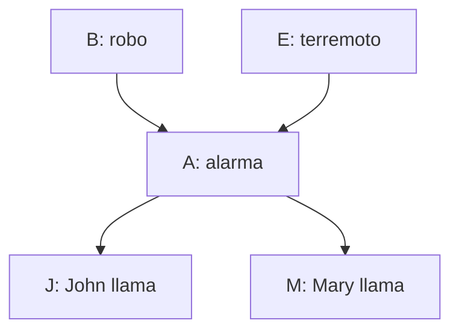

# Inferencia en redes bayesianas: de sumar mundos a eliminar variables

> [!summary] Pregunta central
> Si una red bayesiana describe cómo se relacionan varias variables, ¿cómo calculamos la probabilidad de algo que no observamos usando lo que sí sabemos, y cómo evitamos repetir cálculos innecesarios?

Continuación de [[2026-10-06 IA - Redes bayesianas|Redes bayesianas: independencia y d-separación]]. En esa nota aprendimos **qué distribución representa la red** y **qué independencias garantiza su grafo**. Ahora construiremos un procedimiento para responder consultas numéricas. La fecha **13 de octubre de 2026** corresponde a la sesión indicada; el PDF se titula «Clase 15: inferencia en redes Bayesianas», una numeración distinta de la planeación del curso.

**Cómo estudiar este apunte.** Sigue el orden de las secciones: primero una tabla pequeña, después una cadena de tres variables y finalmente la red de alarma. Antes de mirar cada resultado, intenta anticipar qué debemos fijar, qué debemos sumar y qué debemos conservar. Las ecuaciones generales aparecen después de los ejemplos que les dan significado.

![[AI 15 Inferencia en redes bayesianas.pdf]]

## Ruta incremental y relación con el PDF

| Etapa | Pregunta que aprenderemos a responder | Diapositivas | Secciones |
|---|---|---|---|
| Recuperar lo anterior | ¿Qué información aporta la estructura? | 3–7 | §1 |
| Formular una consulta | ¿Cuál es la incógnita y qué está observado? | 8–9 | §2 |
| Condicionar una tabla | ¿Por qué seleccionamos y después normalizamos? | 11–14 | §§3–4 |
| Enumerar | ¿Por qué sumamos las variables ocultas? | 9–10, 15 | §§5–6 |
| Operar con factores | ¿Qué significa unir y eliminar? | 16–21 | §7 |
| Eliminar paso a paso | ¿Cómo obtenemos el mismo resultado con tablas menores? | 22–28 | §§8–10 |
| Elegir el orden | ¿Cuándo aparecen factores enormes? | 29–31 | §§11–12 |
| Consolidar | ¿Puedo explicar el procedimiento sin memorizarlo? | Síntesis; 32 como puente | §§13–15 |

**Procedencia.** Las tablas de temperatura, estaciones y la cadena $R\to T\to L$ se transcriben del PDF. Las cuentas y explicaciones se desarrollan aquí. La red de alarma usa la estructura del PDF y las CPT ya verificadas en la clase anterior y en AIMA, figura 13.2. Las ampliaciones sobre enumeración recursiva, complejidad y variables irrelevantes se identifican como apoyo de AIMA, 4.ª edición global, §13.3, pp. 445–452; no son transcripciones literales de las diapositivas.

## 1. Recuperar la idea necesaria: la red ya contiene la conjunta

*Diapositivas 3–7; repaso de la sesión anterior.* Una red bayesiana es un DAG junto con distribuciones locales. La distribución conjunta se recupera multiplicando una distribución por nodo:

$$P(x_1,\ldots,x_n)=\prod_{i=1}^{n}P(x_i\mid\operatorname{pa}(X_i)).$$

En la cadena $R\rightarrow T\rightarrow L$:

$$P(r,t,l)=P(r)P(t\mid r)P(l\mid t).$$

Cada término describe una parte del modelo. Su producto describe **un mundo completo**: una asignación de valores a todas las variables.

La d-separación responde una pregunta estructural: «¿se garantiza que una variable no aporte información sobre otra, dada cierta evidencia?». La inferencia responde otra pregunta: «¿cuánto vale una probabilidad en este modelo?». Para la segunda necesitamos los números de las tablas, además del grafo.

### Tres comprobaciones antes de avanzar

| Red del repaso | Consulta de independencia | Resultado y motivo |
|---|---|---|
| $R\to T\leftarrow B$, $T\to T'$ | $R\perp B$ | Garantizada: el colisionador $T$ y sus descendientes están sin observar. |
| La misma red | $R\perp B\mid T'$ | No garantizada: observar un descendiente abre el colisionador. |
| $R\to T$, $R\to D$, $T\to S\leftarrow D$ | $T\perp D\mid R$ | Garantizada: se bloquea la causa común y el colisionador sigue cerrado. |
| La misma red | $T\perp D\mid R,S$ | No garantizada: observar $S$ abre el camino inferior. |

El ejemplo 2, con $L\to R\to T\leftarrow B$, muestra además que observar $T$ abre el colisionador, pero observar también $R$ bloquea ese camino: se garantiza $L\perp B\mid T,R$. Las soluciones completas de los tres ejemplos están en [[2026-10-06 IA - Redes bayesianas#8. Los tres ejemplos de las diapositivas, resueltos paso a paso|§8 de la clase anterior]].

**Qué conservamos de este repaso:** las independencias justifican la factorización compacta. Un camino activo retira una garantía de independencia; por sí solo no proporciona una probabilidad ni demuestra dependencia para todas las CPT posibles.

## 2. Formular la pregunta antes de calcular

*Diapositivas 8–9.* En una consulta $P(Q\mid\mathbf e)$ distinguimos tres papeles:

| Papel | Qué representa | Qué haremos con él |
|---|---|---|
| Consulta $Q$ | Variable cuya distribución queremos conocer | Conservar todos sus valores posibles |
| Evidencia $\mathcal E$, con valores $\mathbf e$ | Variables observadas | Fijar los valores observados |
| Ocultas $\mathcal H$ | Variables restantes | Sumar sobre todos sus valores posibles |

Por ejemplo, en la red de alarma, $P(B\mid j,m)$ pregunta por robo $B$ cuando John y Mary llaman. $B$ es la consulta; $J=\text{verdadero}$ y $M=\text{verdadero}$ son evidencia; alarma $A$ y terremoto $E$ permanecen ocultos.

> [!note] Convención de símbolos
> Mayúsculas nombran variables; minúsculas nombran un valor concreto. Para variables booleanas, $r$ o $+r$ significa $R=\text{verdadero}$ y $\neg r$ o $-r$ significa $R=\text{falso}$. **$E$ es terremoto en la red de alarma**; usamos $\mathcal E$ para el conjunto de evidencia y $\mathbf e$ para sus valores, evitando confundirlos.

### Una distribución y su valor más probable son respuestas distintas

Una consulta posterior devuelve números para todos los valores:

$$P(B\mid j,m)\approx\langle0.284172,\ 0.715828\rangle,$$

en el orden $(b,\neg b)$. La consulta $\arg\max_b P(B=b\mid j,m)$ devuelve un valor: aquí, «no robo».

Si $Q$ es un subconjunto de variables, maximizar $P(Q\mid\mathbf e)$ es una consulta **MAP**. Si se busca la asignación más probable de **todas** las variables no observadas, hablamos de **MPE**. La diapositiva 8 usa «explicación más probable» en sentido amplio; este apunte desarrolla el cálculo de distribuciones posteriores, que requiere sumar las ocultas. No sustituimos esas sumas por máximos.

## 3. Primer peldaño: condicionar es seleccionar y normalizar

*Diapositivas 11–13.* Empecemos sin grafo. Tenemos la conjunta de temperatura $T$ y tiempo $W$:

| $T$ | $W$ | $P(T,W)$ |
|---|---|---:|
| Calor | Sol | 0.4 |
| Calor | Lluvia | 0.1 |
| Frío | Sol | 0.2 |
| Frío | Lluvia | 0.3 |

Queremos $P(W\mid T=\text{frío})$.

**Paso 1: seleccionar los mundos compatibles.** Saber que hace frío descarta las primeras dos filas. Sobreviven las masas $0.2$ y $0.3$.

**Paso 2: calcular cuánto pesa la evidencia.** La probabilidad de frío es la suma de esos mundos:

$$P(T=\text{frío})=0.2+0.3=0.5.$$

**Paso 3: cambiar el total de referencia.** Dentro de los mundos con frío, sol representa $0.2/0.5$ y lluvia representa $0.3/0.5$:

$$P(W\mid T=\text{frío})=\langle0.4,0.6\rangle.$$

La selección $\langle0.2,0.3\rangle$ todavía expresa masas respecto del universo original. La normalización expresa las proporciones **dentro del conjunto compatible con la observación**.

### Resolver el quiz de la diapositiva 13

La conjunta es:

| $X$ | $Y$ | Probabilidad |
|---|---|---:|
| $+x$ | $+y$ | 0.2 |
| $+x$ | $-y$ | 0.3 |
| $-x$ | $+y$ | 0.4 |
| $-x$ | $-y$ | 0.1 |

Para $P(X\mid Y=-y)$, seleccionamos $0.3$ y $0.1$. La evidencia pesa $0.4$; por tanto:

$$P(+x\mid-y)=\frac{0.3}{0.4}=0.75,\qquad P(-x\mid-y)=\frac{0.1}{0.4}=0.25.$$

**Comprobación:** ambas probabilidades suman uno. Conservar $0.3$ y $0.1$ como respuesta confundiría una selección de la conjunta con una distribución condicional.

## 4. Segundo peldaño: sumar lo desconocido antes de normalizar

*Diapositiva 14.* Añadimos una variable: estación $S$. Los valores de la tabla son:

| $S$ | $T$ | $W$ | $P(S,T,W)$ |
|---|---|---|---:|
| Verano | Calor | Sol | 0.30 |
| Verano | Calor | Lluvia | 0.05 |
| Verano | Frío | Sol | 0.10 |
| Verano | Frío | Lluvia | 0.05 |
| Invierno | Calor | Sol | 0.10 |
| Invierno | Calor | Lluvia | 0.05 |
| Invierno | Frío | Sol | 0.15 |
| Invierno | Frío | Lluvia | 0.20 |

### 4.1 Sin evidencia: $P(W)$

No conocemos estación ni temperatura. Para calcular sol, sumamos **todos los mundos que tienen sol**, aunque difieran en las otras dos variables:

$$P(\text{sol})=0.30+0.10+0.10+0.15=0.65.$$

Análogamente, $P(\text{lluvia})=0.35$. Esto se llama **marginalizar** $S,T$: dejan de aparecer en la respuesta, pero sus posibilidades contribuyeron a ella.

### 4.2 Una observación: $P(W\mid\text{invierno})$

1. Seleccionar las cuatro filas de invierno.
2. Sumar la temperatura, que sigue desconocida: sol pesa $0.10+0.15=0.25$ y lluvia pesa $0.05+0.20=0.25$.
3. Normalizar por $P(\text{invierno})=0.50$.

$$P(W\mid\text{invierno})=\langle0.5,0.5\rangle.$$

### 4.3 Dos observaciones: $P(W\mid\text{invierno},\text{calor})$

Ahora sobreviven solo dos filas, con pesos $0.10$ y $0.05$. No queda ninguna variable oculta:

$$
P(W\mid\text{invierno},\text{calor})
=\left\langle\frac{0.10}{0.15},\frac{0.05}{0.15}\right\rangle
=\left\langle\frac23,\frac13\right\rangle.
$$

**Qué cambió entre las tres consultas:** fijamos diferentes evidencias y sumamos diferentes variables. La conjunta sigue siendo la misma.

## 5. La regla general ya tiene significado

*Diapositivas 9–10.* Llamemos $w(q)$ al peso de los mundos donde la consulta vale $q$ y se cumple la evidencia:

$$\boxed{w(q)=P(q,\mathbf e)=\sum_{\mathbf h}P(q,\mathbf e,\mathbf h).}$$

La suma recorre **asignaciones completas** de las variables ocultas. Si hay dos ocultas booleanas, hay cuatro combinaciones, no dos.

Sumando los pesos de todos los valores de la consulta recuperamos la masa de la evidencia:

$$Z=\sum_q w(q)=P(\mathbf e).$$

Por definición de probabilidad condicional:

$$\boxed{P(q\mid\mathbf e)=\frac{w(q)}{Z}=\alpha w(q),\qquad\alpha=\frac1Z.}$$

En una red bayesiana, cada mundo se obtiene mediante los factores locales:

$$P(q\mid\mathbf e)=\alpha\sum_{\mathbf h}\prod_i P(x_i\mid\operatorname{pa}(X_i)),$$

evaluando el producto en la asignación formada por $q,\mathbf e,\mathbf h$.

> [!important] Condición de la normalización
> Debe cumplirse $Z>0$. Si el modelo asigna probabilidad cero a la evidencia, esta fórmula no define una posterior. Revisamos la evidencia y el modelo; dividir entre cero no produce una distribución válida.

Sin evidencia, $Z=1$. Si la consulta contiene varias variables, $q$ recorre todas las configuraciones conjuntas de esas variables.

## 6. Enumeración: una cadena pequeña que podemos resolver a mano

*Datos de las diapositivas 18–22.* Usaremos $R\to T\to L$. Podemos recordar $R$ como lluvia, $T$ como tráfico y $L$ como llegar tarde; esos nombres son una interpretación didáctica. Los números son los del PDF:

$$P(r)=0.1,\qquad P(\neg r)=0.9.$$

| $R$ | $P(t\mid R)$ | $P(\neg t\mid R)$ |
|---|---:|---:|
| $r$ | 0.8 | 0.2 |
| $\neg r$ | 0.1 | 0.9 |

| $T$ | $P(l\mid T)$ | $P(\neg l\mid T)$ |
|---|---:|---:|
| $t$ | 0.3 | 0.7 |
| $\neg t$ | 0.1 | 0.9 |

### Paso 1: definir los papeles

Queremos $P(L)$: consulta $L$, sin evidencia, ocultas $R,T$.

### Paso 2: obtener los ocho mundos

Cada fila se calcula como $P(R)P(T\mid R)P(L\mid T)$:

| $R$ | $T$ | $L$ | Probabilidad conjunta |
|---|---|---|---:|
| $r$ | $t$ | $l$ | $0.1(0.8)(0.3)=0.024$ |
| $r$ | $t$ | $\neg l$ | $0.1(0.8)(0.7)=0.056$ |
| $r$ | $\neg t$ | $l$ | $0.1(0.2)(0.1)=0.002$ |
| $r$ | $\neg t$ | $\neg l$ | $0.1(0.2)(0.9)=0.018$ |
| $\neg r$ | $t$ | $l$ | $0.9(0.1)(0.3)=0.027$ |
| $\neg r$ | $t$ | $\neg l$ | $0.9(0.1)(0.7)=0.063$ |
| $\neg r$ | $\neg t$ | $l$ | $0.9(0.9)(0.1)=0.081$ |
| $\neg r$ | $\neg t$ | $\neg l$ | $0.9(0.9)(0.9)=0.729$ |

### Paso 3: sumar los mundos que coinciden en la consulta

$$P(l)=0.024+0.002+0.027+0.081=0.134,$$
$$P(\neg l)=0.056+0.018+0.063+0.729=0.866.$$

La respuesta es $P(L)=\langle0.134,0.866\rangle$ en el orden $(l,\neg l)$. No hace falta cambiar su escala: ya suma uno.

### Paso 4: encontrar el trabajo que se repite

El producto $P(r)P(t\mid r)=0.08$ aparece para $l$ y para $\neg l$. Lo mismo ocurre con los otros valores de $R,T$. Y la suma de esos productos para un mismo $T$ puede reutilizarse antes de incorporar $L$.

**Pregunta que motiva el siguiente método:** ¿podemos resumir $R$ en una tabla sobre $T$ y usar ese resumen para ambos valores de $L$?

> [!note] Precisión sobre la diapositiva 15
> Construir la conjunta completa y luego sumar es una implementación sencilla de enumeración. **Enumerar no exige almacenarla completa**: el algoritmo recursivo de AIMA, §13.3.1, recorre asignaciones y acumula sus pesos con espacio lineal. El problema general sigue siendo el número exponencial de combinaciones y la repetición de subcálculos.

## 7. Factores: tablas sobre las que podemos operar

*Diapositivas 17–21; AIMA, pp. 448–450.* Un [[Factor probabilístico|factor]] es una función no negativa sobre un conjunto de variables. Su **alcance** o *scope* es el conjunto de variables que indexan su tabla.

Al comenzar, usamos las CPT como factores. Por ejemplo, $f(R,T)=P(T\mid R)$ tiene alcance $\{R,T\}$. Aunque la notación tenga una barra, necesitamos ambos valores para buscar una entrada.

Un factor intermedio puede expresar una conjunta, una probabilidad de evidencia o simplemente un producto parcial. **No tiene que sumar uno**. La CPT $P(T\mid R)$ suma uno sobre $T$ para cada $R$; si sumamos sus cuatro entradas, obtenemos dos.

### Operación 1: restringir por evidencia

Si observamos $R=r$, sustituimos ese valor en todos los factores que mencionan $R$:

$$P(R)\longrightarrow P(r)=0.1,$$
$$P(T\mid R)\longrightarrow f(T)=P(T\mid r)=\langle0.8,0.2\rangle.$$

El primer factor queda como un **escalar**; el segundo ya solo depende de $T$. Seleccionar $R=r$ no es sumar sobre $R$: sabemos su valor.

### Operación 2: unir factores es multiplicar entradas compatibles

Si $f(R)=P(R)$ y $g(R,T)=P(T\mid R)$, su producto es:

$$h(R,T)=f(R)g(R,T)=P(R,T).$$

| $R$ | $T$ | $h(R,T)$ |
|---|---|---:|
| $r$ | $t$ | $0.1(0.8)=0.08$ |
| $r$ | $\neg t$ | $0.1(0.2)=0.02$ |
| $\neg r$ | $t$ | $0.9(0.1)=0.09$ |
| $\neg r$ | $\neg t$ | $0.9(0.9)=0.81$ |

En general, al multiplicar $f(X,Y)$ por $g(Y,Z)$ obtenemos $h(X,Y,Z)$: **el alcance es la unión de los alcances** y el valor compartido de $Y$ debe coincidir. La operación es un producto punto a punto sobre asignaciones compatibles, no multiplicación de matrices.

### Operación 3: eliminar una variable es sumar sobre sus valores

Para eliminar $R$ de $h(R,T)$:

$$k(T)=\sum_R h(R,T).$$

Así, $k(t)=0.08+0.09=0.17$ y $k(\neg t)=0.02+0.81=0.83$.

El factor resultante conserva la probabilidad total de cada valor de $T$, sin conservar el detalle sobre $R$.

> [!important] Eliminar no significa borrar datos
> Si queremos quitar $R$, debemos **multiplicar todos los factores que todavía mencionan $R$ y después sumar $R$**. Borrar un factor o sumar cada factor por separado perdería relaciones necesarias. En general, $\sum_R f(R)g(R,T)\ne(\sum_R f(R))(\sum_R g(R,T))$.

## 8. Eliminación de variables: la misma cadena con tablas menores

*Diapositivas 22 y 25.* Queremos otra vez $P(L)$. Ahora usaremos el orden $R,T$.

### Paso 1: escribir los factores iniciales

$$\mathcal F=\{P(R),\ P(T\mid R),\ P(L\mid T)\}.$$

### Paso 2: eliminar $R$

Solo $P(R)$ y $P(T\mid R)$ mencionan $R$. Los multiplicamos y sumamos:

$$f_1(T)=\sum_R P(R)P(T\mid R)=P(T).$$

Ya calculamos $f_1(t)=0.17$, $f_1(\neg t)=0.83$. Sustituimos los dos factores usados por este resumen:

$$\mathcal F=\{f_1(T),\ P(L\mid T)\}.$$

El factor $P(L\mid T)$ queda pendiente porque no dependía de $R$.

### Paso 3: unir los factores que mencionan $T$

$$g(T,L)=f_1(T)P(L\mid T).$$

| $T$ | $L$ | $g(T,L)$ |
|---|---|---:|
| $t$ | $l$ | $0.17(0.3)=0.051$ |
| $t$ | $\neg l$ | $0.17(0.7)=0.119$ |
| $\neg t$ | $l$ | $0.83(0.1)=0.083$ |
| $\neg t$ | $\neg l$ | $0.83(0.9)=0.747$ |

### Paso 4: eliminar $T$

$$f_2(L)=\sum_T g(T,L).$$

Por tanto, $f_2(l)=0.051+0.083=0.134$ y $f_2(\neg l)=0.119+0.747=0.866$. Recuperamos exactamente la misma distribución.

### Por qué podemos cambiar el orden de las cuentas

$$
\begin{aligned}
P(L)&=\sum_T\sum_R P(R)P(T\mid R)P(L\mid T)\\
&=\sum_T P(L\mid T)\underbrace{\sum_R P(R)P(T\mid R)}_{f_1(T)}.
\end{aligned}
$$

Sacamos $P(L\mid T)$ de la suma sobre $R$ porque **no depende de $R$**. Usamos la propiedad distributiva y guardamos el resultado de la suma interna. Esa reutilización conecta con [[Programación dinámica|programación dinámica]].

| Procedimiento de esta comparación | Mayor alcance de un producto construido | Filas, si todas son booleanas |
|---|---|---:|
| Formar la conjunta completa | $R,T,L$ | 8 |
| Eliminar $R$ y después $T$ | $R,T$ o $T,L$ | 4 |

La comparación se refiere a formar tablas explícitas. La enumeración recursiva puede evitar almacenar las ocho filas y sigue recorriendo sus combinaciones.

### Laboratorio: seguir las tablas que se transforman

<iframe src="ia15-enumeracion-eliminacion.htm" style="width:100%;height:600px;border:1px solid var(--lightgray);border-radius:4px;" loading="lazy"></iframe>

Empieza en **Cadena: $P(L)$** y avanza por los pasos. Compara **Enumeración** con **Eliminación**: cambia cuándo se multiplica y cuándo se suma, pero ambas terminan en $\langle0.134,0.866\rangle$. Después selecciona **Cadena: $P(L\mid+r)$** y sigue la restricción de evidencia. Si el recurso no carga, las tablas de §§6–9 muestran todas las operaciones necesarias.

## 9. Incorporar evidencia: $P(L\mid r)$

*Diapositiva 23.* Ahora sabemos que llueve. Consulta $L$, evidencia $R=r$, oculta $T$.

### Paso 1: restringir antes de operar

$$\mathcal F=\{P(r)=0.1,\ P(T\mid r),\ P(L\mid T)\}.$$

### Paso 2: eliminar la única oculta

$$f(L)=\sum_T P(T\mid r)P(L\mid T).$$

$$f(l)=0.8(0.3)+0.2(0.1)=0.26,$$
$$f(\neg l)=0.8(0.7)+0.2(0.9)=0.74.$$

### Paso 3: recuperar los pesos conjuntos

Multiplicamos el factor escalar pendiente $P(r)$:

$$w(L)=0.1f(L)=\langle0.026,0.074\rangle=P(L,r).$$

### Paso 4: normalizar

$$Z=0.026+0.074=0.1,$$
$$P(L\mid r)=\frac{\langle0.026,0.074\rangle}{0.1}=\langle0.26,0.74\rangle.$$

**Interpretación:** sin conocer la lluvia, llegar tarde tenía probabilidad $13.4\%$; al saber que llueve, tiene $26\%$ en este modelo. La evidencia cambia el peso relativo de las posibilidades de tráfico.

Podríamos cancelar desde el principio el escalar positivo $P(r)$, común a todos los valores de $L$, si solo queremos la posterior. Aquí lo conservamos para ver que la suma de los pesos conjuntos es $P(r)$. Si cancelamos escalares, ya no debemos interpretar automáticamente la suma final como la masa original de la evidencia.

## 10. Convergencia: resolver la red de alarma con ambos métodos

*Diapositivas 10 y 26–28; CPT de la clase anterior y AIMA.* La estructura es:



$$P(B,E,A,J,M)=P(B)P(E)P(A\mid B,E)P(J\mid A)P(M\mid A).$$

Queremos $P(B\mid j,m)$. Conservamos $B$, fijamos $J,M$ y sumamos $A,E$.

### 10.1 Recuperar los datos necesarios

$$P(b)=0.001,\qquad P(e)=0.002.$$

| $B$ | $E$ | $P(a\mid B,E)$ |
|---|---|---:|
| $b$ | $e$ | 0.95 |
| $b$ | $\neg e$ | 0.94 |
| $\neg b$ | $e$ | 0.29 |
| $\neg b$ | $\neg e$ | 0.001 |

| $A$ | $P(j\mid A)$ | $P(m\mid A)$ |
|---|---:|---:|
| $a$ | 0.90 | 0.70 |
| $\neg a$ | 0.05 | 0.01 |

Las probabilidades de los valores falsos se obtienen por complemento dentro de cada distribución local. Por ejemplo, $P(\neg a\mid b,e)=0.05$.

### 10.2 Enumeración: sumar los ocho mundos compatibles

La evidencia fija dos de las cinco variables. Quedan dos valores de $B$ y cuatro combinaciones de $A,E$:

$$w(B)=\sum_E\sum_A P(B)P(E)P(A\mid B,E)P(j\mid A)P(m\mid A).$$

| $B$ | $E$ | $A$ | $P(B,E,A,j,m)$ |
|---|---|---|---:|
| $b$ | $e$ | $a$ | 0.000001197000 |
| $b$ | $e$ | $\neg a$ | 0.000000000050 |
| $b$ | $\neg e$ | $a$ | 0.000591015600 |
| $b$ | $\neg e$ | $\neg a$ | 0.000000029940 |
| $\neg b$ | $e$ | $a$ | 0.000365034600 |
| $\neg b$ | $e$ | $\neg a$ | 0.000000709290 |
| $\neg b$ | $\neg e$ | $a$ | 0.000628111260 |
| $\neg b$ | $\neg e$ | $\neg a$ | 0.000498002499 |

Por ejemplo, la primera fila es $(0.001)(0.002)(0.95)(0.90)(0.70)$. Sumando por $B$:

$$w(b)=0.000592242590,\qquad w(\neg b)=0.001491857649.$$

### 10.3 Eliminación: primero $A$, después $E$

**Paso 1: factores restringidos.**

$$\mathcal F=\{P(B),P(E),P(A\mid B,E),P(j\mid A),P(m\mid A)\}.$$

$P(j\mid A)$ y $P(m\mid A)$ son factores sobre **$A$**, porque $J,M$ ya están fijos. No son posteriores sobre $A$ ni suman necesariamente uno al sumar $A$.

**Paso 2: unir todos los factores con $A$ y eliminar $A$.**

$$g(B,E)=\sum_A P(A\mid B,E)P(j\mid A)P(m\mid A).$$

Si hay alarma, las dos llamadas pesan $0.90(0.70)=0.63$; si no hay alarma, pesan $0.05(0.01)=0.0005$. Para cada configuración de $B,E$:

$$g(B,E)=0.63P(a\mid B,E)+0.0005[1-P(a\mid B,E)].$$

| $B$ | $E$ | $g(B,E)=P(j,m\mid B,E)$ |
|---|---|---:|
| $b$ | $e$ | 0.598525 |
| $b$ | $\neg e$ | 0.592230 |
| $\neg b$ | $e$ | 0.183055 |
| $\neg b$ | $\neg e$ | 0.0011295 |

Para verificar la primera entrada: $0.95(0.63)+0.05(0.0005)=0.598525$. Después de sumar $A$, la lista de factores es $\{P(B),P(E),g(B,E)\}$.

**Paso 3: unir todos los factores con $E$ y eliminar $E$.**

$$h(B)=\sum_E P(E)g(B,E).$$

$$h(b)=0.002(0.598525)+0.998(0.592230)=0.59224259,$$
$$h(\neg b)=0.002(0.183055)+0.998(0.0011295)=0.001493351.$$

Estos valores son $P(j,m\mid B)$: la probabilidad de ambas llamadas para cada estado de robo. **Todavía no** son $P(B\mid j,m)$.

**Paso 4: unir los factores restantes.**

$$w(B)=P(B)h(B).$$

$$w(b)=0.001(0.59224259)=0.000592242590,$$
$$w(\neg b)=0.999(0.001493351)=0.001491857649.$$

Son exactamente los pesos que dio la enumeración. Escribimos $P(B)$ una sola vez: no vuelve a multiplicarse al sumar cada variable.

**Paso 5: normalizar.**

$$Z=P(j,m)=0.002084100239,$$
$$\boxed{P(b\mid j,m)=\frac{0.000592242590}{0.002084100239}\approx0.284172.}$$

La previa de robo era $0.1\%$; la posterior es aproximadamente **$28.42\%$**. Las llamadas aumentan mucho la creencia en robo, pero no lo vuelven seguro: también pueden surgir por terremoto o por falsos positivos del modelo.

### 10.4 La ecuación que resume todo el procedimiento

$$
\begin{aligned}
P(B\mid j,m)
&=\alpha\sum_E\sum_A P(B)P(E)P(A\mid B,E)P(j\mid A)P(m\mid A)\\
&=\alpha P(B)\sum_E P(E)\underbrace{\sum_A P(A\mid B,E)P(j\mid A)P(m\mid A)}_{g(B,E)}\\
&=\alpha P(B)h(B).
\end{aligned}
$$

Esta es la misma idea de la cadena, aplicada a una red mayor: mover fuera de cada suma lo que no depende de la variable sumada y conservar los resúmenes para reutilizarlos.

En el laboratorio de §8, selecciona **Alarma: $P(B\mid j,m)$** y compara los órdenes **$A,E$** y **$E,A$**. Ambos producen la misma posterior; cambian las tablas intermedias. El ejemplo completo conserva los cinco factores de la factorización, por lo que también puedes rastrear cuándo se usa cada uno.

## 11. Convertir los ejemplos en un algoritmo

*Diapositiva 24.* Para calcular $P(Q\mid\mathbf e)$:

```text
F ← factores locales de la red restringidos a la evidencia
H ← variables que no son consulta ni evidencia
elegir un orden para H

para cada variable V del orden:
    S ← todos los factores de F cuyo alcance contiene V
    g ← producto de los factores de S
    h ← suma de g sobre todos los valores de V
    F ← quitar S de F y agregar h

w ← producto de los factores que quedan en F
Z ← suma de w sobre todos los valores de la consulta
si Z = 0: la posterior no está definida por este modelo
devolver w / Z
```

**Invariante que permite confiar en el procedimiento:** el producto de los factores actuales representa la conjunta restringida a la evidencia, después de sumar las variables que ya eliminamos. Cada reemplazo conserva esa cantidad; cambia su representación, no su valor.

No eliminamos una variable consultada: necesitamos que siga indexando la respuesta. Una variable observada ya quedó fijada por la restricción. Al terminar, solo deben permanecer variables de consulta y escalares.

La descripción de las dos operaciones coincide con [Berkeley CS 188, §6.6](https://inst.eecs.berkeley.edu/~cs188/textbook/bayes-nets/elimination.html). La justificación y el ejemplo de alarma se desarrollan en AIMA, §13.3.2, pp. 448–450.

### Ampliación AIMA: una variable puede ser irrelevante

Para consultar $P(J\mid b)$, Mary no está observada ni es consulta. Como es una hoja:

$$\sum_M P(M\mid A)=1.$$

Podemos quitar esa rama antes de calcular. Repitiendo el argumento con hojas que dejan de ser relevantes, basta conservar consulta, evidencia y sus ancestros (AIMA, pp. 450–451). Esto **no** permite quitar cualquier variable oculta: en $P(B\mid j,m)$, $A,E$ contribuyen a la probabilidad de la evidencia y deben marginalizarse.

## 12. El orden cambia el costo, aunque no cambie la respuesta

*Diapositiva 29.* Consideremos una causa común $Z$ con ramas $Z\to X_i\to Y_i$, para $i=1,\ldots,n$. Todas las $Y_i=y_i$ están observadas y queremos $P(X_n\mid y_1,\ldots,y_n)$.

Después de restringir la evidencia, tenemos:

$$P(Z)\prod_{i=1}^{n}P(X_i\mid Z)P(y_i\mid X_i).$$

Las ocultas son $Z,X_1,\ldots,X_{n-1}$. $X_n$ se conserva como consulta.

### 12.1 Eliminar primero las ramas: $X_1,\ldots,X_{n-1},Z$

Para cada rama que no contiene la consulta:

$$m_i(Z)=\sum_{X_i}P(X_i\mid Z)P(y_i\mid X_i).$$

El producto previo a la suma tiene alcance $\{Z,X_i\}$: cuatro entradas si ambas variables son booleanas. El resumen $m_i(Z)$ tiene dos entradas.

Tras eliminar esas ramas, solo falta:

$$w(X_n)=P(y_n\mid X_n)\sum_Z P(Z)P(X_n\mid Z)\prod_{i=1}^{n-1}m_i(Z).$$

El mayor producto sigue necesitando como máximo dos variables. Cada rama entrega un pequeño resumen sobre $Z$.

### 12.2 Eliminar primero la causa común: $Z,X_1,\ldots,X_{n-1}$

Para eliminar $Z$, debemos reunir $P(Z)$ y **todas** las CPT $P(X_i\mid Z)$:

$$g(X_1,\ldots,X_n)=\sum_Z P(Z)\prod_{i=1}^{n}P(X_i\mid Z).$$

El producto previo depende de $Z,X_1,\ldots,X_n$: $n+1$ variables. El resultado de la suma conserva las $n$ variables $X_i$ juntas. Creamos una tabla grande antes de resumir las ramas.

| Orden, con variables booleanas | Mayor producto antes de sumar | Mayor factor nuevo después de sumar |
|---|---:|---:|
| Ramas primero | $2^2=4$ entradas | $2$ entradas |
| $Z$ primero | $2^{n+1}$ entradas | $2^n$ entradas |

Para $n=6$, son **4 frente a 128 entradas** en el mayor producto. Después de sumar una variable, la comparación es **2 frente a 64**. Especificar cuál tabla estamos contando evita confundir ambas cifras; esta distinción también aparece en las [diapositivas de Berkeley, 2025, pp. 35–36 del PDF](https://inst.eecs.berkeley.edu/~cs188/sp25/assets/lectures/cs188-sp25-lec15.pdf).

### Explorador del orden y los alcances

<iframe src="ia15-orden-eliminacion.htm" style="width:100%;height:600px;border:1px solid var(--lightgray);border-radius:4px;" loading="lazy"></iframe>

Compara ambos órdenes con seis ramas y avanza una eliminación a la vez. El explorador muestra qué factores entran, qué variables debe reunir el producto y cuántas entradas requiere. Al aumentar las ramas, el orden que elimina $Z$ primero crece exponencialmente; el otro mantiene productos de cuatro entradas. El recurso estudia **alcances y tamaños**, sin inventar probabilidades para la diapositiva 29.

### Qué orienta la elección en otras redes

Con variables de distinto dominio, un factor de alcance $S$ necesita $\prod_{X\in S}|\operatorname{Dom}(X)|$ entradas si se representa como tabla densa. Contar solo nodos puede ocultar diferencias enormes de cardinalidad.

Una heurística práctica es preferir la siguiente eliminación que produzca una tabla pequeña. Otra, *min-fill*, intenta agregar pocas conexiones entre los vecinos de la variable eliminada en el grafo de interacción de factores. Son heurísticas, no garantías de encontrar el mejor orden. El mejor orden general puede ser difícil de encontrar y, aun encontrándolo, algunas redes exigen factores grandes. AIMA, p. 450, discute el orden y la relevancia de variables.

## 13. Los límites: exactitud, dificultad y poliárboles

*Diapositivas 8, 16 y 30–32; ampliación AIMA, §13.3.3.* Enumeración y eliminación son métodos **exactos**: calculan la posterior del modelo, salvo el redondeo de una implementación numérica. Exacto no significa que el modelo describa perfectamente la realidad; depende de sus supuestos y CPT.

### Por qué no existe una promesa de rapidez para cualquier red

La diapositiva 30 codifica una fórmula lógica en una red. Las variables proposicionales son raíces booleanas independientes con probabilidad $1/2$; otros nodos evalúan cláusulas OR y combinaciones AND mediante CPT deterministas.

1. Cada asignación de las $n$ raíces pesa $2^{-n}$.
2. El nodo final $Z$ vale verdadero exactamente en las asignaciones que satisfacen la fórmula.
3. Si hay $N_{\mathrm{sat}}$ asignaciones satisfactorias, $P(Z=\text{verdadero})=N_{\mathrm{sat}}/2^n$.
4. Saber si esa probabilidad es mayor que cero permite decidir satisfacibilidad.

Las operaciones AND pueden organizarse en una cascada de nodos pequeños, de modo que el modelo no requiera desde el inicio una CPT con todas las cláusulas como padres. La dificultad puede surgir en los factores intermedios, aun cuando las CPT iniciales sean pequeñas.

> [!warning] Precisión de complejidad
> La diapositiva 16 dice «NP-completo», pero calcular una probabilidad exacta es una tarea numérica. La conclusión segura para el problema general es **NP-difícil**; AIMA, pp. 451–452, explica además su dificultad de conteo, **#P-difícil**. Las versiones de decisión requieren una formulación precisa antes de asignarles una clase. El método de eliminación no elimina esa dificultad general.

### Poliárboles: estructura que sí permite un orden eficiente

Un **poliárbol** es un DAG cuyo grafo subyacente no tiene ciclos no dirigidos: hay a lo sumo un camino no dirigido entre dos nodos. Puede tener un nodo con varios padres, como $B\to A\leftarrow E$. Si hay varias componentes, se habla también de un bosque de poliárboles.

Todos los modelos bayesianos de esta clase son DAG, pero no todos son poliárboles. La red $R\to T$, $R\to D$, $T\to S\leftarrow D$ tiene un ciclo al ignorar flechas y no es un poliárbol.

En poliárboles existe una estrategia eficiente para inferencia exacta. AIMA, p. 451, mide el tamaño de la red por las **entradas de sus CPT**: la inferencia puede ser lineal en ese tamaño. Para traducirlo a «lineal en nodos» también necesitamos que los dominios y el número de padres estén acotados. Una CPT con muchos padres puede ser enorme aunque el grafo no tenga ciclos no dirigidos. Y el ejemplo de §12 demuestra que elegir un mal orden puede desperdiciar una estructura favorable.

La siguiente sesión del material introduce **inferencia aproximada por muestreo**. No asumimos que toda consulta requiere aproximación: primero evaluamos la estructura, el orden y el tamaño de los factores que se producirían.

## 14. Práctica para reconstruir el razonamiento

Intenta resolver sin desplegar las respuestas. Escribe primero **consulta, evidencia y ocultas**; después los factores y las sumas.

### A. Normalización

Dos valores de una consulta tienen pesos $0.06$ y $0.14$. ¿Cuál es la masa de la evidencia y cuál es la posterior?

> [!check]- Solución A
> Si son pesos conjuntos completos, $Z=0.06+0.14=0.20=P(\mathbf e)$. La posterior es $\langle0.3,0.7\rangle$. Si se eliminaron escalares positivos antes de obtenerlos, normalizar sigue siendo válido, pero $0.20$ podría ser solo una constante de escala y no $P(\mathbf e)$.

### B. La misma cadena, con otra evidencia

En $R\to T\to L$, calcula $P(L\mid\neg r)$. ¿Qué variable debes sumar?

> [!check]- Solución B
> Consulta $L$, evidencia $R=\text{falso}$, oculta $T$. $P(l\mid\neg r)=0.1(0.3)+0.9(0.1)=0.12$ y $P(\neg l\mid\neg r)=0.88$. Los pesos conjuntos son $0.9\langle0.12,0.88\rangle=\langle0.108,0.792\rangle$ y suman $P(\neg r)=0.9$.

### C. Evidencia en el nodo intermedio

Calcula $P(L\mid t)$ y explica por qué desconocer $R$ ya no cambia la respuesta.

> [!check]- Solución C
> $P(L\mid t)=\langle0.3,0.7\rangle$, directamente de su CPT. $P(R,t,L)=P(R)P(t\mid R)P(L\mid t)$; al sumar $R$ obtenemos $P(t)P(L\mid t)$ y al normalizar se cancela $P(t)$. La independencia $L\perp R\mid T$ justifica el resultado.

### D. Detectar una eliminación incorrecta

Al eliminar $A$ en la red de alarma, alguien suma solo $P(A\mid B,E)$ y obtiene uno. Después conserva $P(j\mid A)$ y $P(m\mid A)$. ¿Qué falló?

> [!check]- Solución D
> No reunió todos los factores que dependían de $A$. Las llamadas siguen mencionando una variable supuestamente eliminada y se perdió su relación con la alarma. La operación correcta es $\sum_A P(A\mid B,E)P(j\mid A)P(m\mid A)$, que produce el factor $g(B,E)$ de §10.

### E. Comparar órdenes en la alarma

Si eliminamos primero $E$, ¿qué alcance tiene el resumen? ¿Cambia $P(B\mid j,m)$?

> [!check]- Solución E
> $u(A,B)=\sum_E P(E)P(A\mid B,E)$ tiene alcance $\{A,B\}$. Después calculamos $h(B)=\sum_A u(A,B)P(j\mid A)P(m\mid A)$ y multiplicamos por $P(B)$. La posterior es la misma: los órdenes válidos cambian la organización de las cuentas, no la suma total.

### F. Predecir una tabla antes de construirla

En §12 con $n=8$, ¿cuántas entradas tiene el producto que construimos para eliminar $Z$ primero? ¿Y el factor después de sumarlo?

> [!check]- Solución F
> Antes: alcance $\{Z,X_1,\ldots,X_8\}$, $2^9=512$ entradas. Después: alcance $\{X_1,\ldots,X_8\}$, $2^8=256$. El orden que elimina las ramas primero mantiene productos de cuatro entradas y resúmenes de dos.

## 15. Criterios de comprensión y errores frecuentes

| Si aparece esta duda o error | Idea que debemos reconstruir |
|---|---|
| «Una oculta se toma como falsa» | No observada significa desconocida; sumamos todos sus valores. |
| «La tabla seleccionada ya es la posterior» | Sus pesos deben dividirse entre su suma, salvo que ya esté normalizada. |
| «Todo factor suma uno» | Una CPT normaliza sobre el hijo para cada configuración de padres; un factor general no tiene esa obligación. |
| «Unir suma tablas» | Unir multiplica entradas compatibles; eliminar suma sobre una variable. |
| «Puedo sumar una variable en cualquier factor aislado» | Debemos reunir todos los factores actuales que la mencionan. |
| «Eliminación aproxima la enumeración» | Ambos métodos son exactos; reordenan la misma expresión. |
| «El orden de eliminación es el orden topológico» | Son decisiones distintas: uno permite evaluar CPT con padres asignados; el otro busca factores pequeños. |
| «Pocas flechas garantizan cálculos pequeños» | Importan alcances, dominios, estructura y orden; debemos estimar las tablas intermedias. |
| «Una posterior alta es una explicación causal demostrada» | Calculamos una creencia condicionada en el modelo; una intervención causal es otra consulta. |

**Antes de considerar dominada la clase, debo poder explicar:** por qué seleccionamos evidencia, por qué sumamos ocultas, por qué normalizamos y por qué la distributividad permite resumir variables sin cambiar la respuesta. Después debo resolver la cadena por ambos métodos y anticipar el alcance de un factor antes de construirlo.

## Conceptos extraídos

- [[Inferencia por enumeración]]: obtener pesos sumando mundos compatibles.
- [[Factor probabilístico]]: la representación sobre la que operan producto, restricción y suma.
- [[Eliminación de variables]]: organizar las sumas para reutilizar resultados y limitar factores intermedios.

## Referencias y alcance

- **Material principal:** [[AI 15 Inferencia en redes bayesianas.pdf|AI 15 — Inferencia en redes bayesianas]], 32 diapositivas. Los números de página coinciden con los de diapositiva.
- **Continuidad:** [[2026-10-06 IA - Redes bayesianas]], especialmente factorizar la conjunta, d-separación y CPT de alarma.
- **AIMA, 4.ª edición global:** [[Artificial_inteliigence-A_modern_approach.pdf|Russell y Norvig, Artificial Intelligence: A Modern Approach]], §13.3.1, pp. 445–447; §13.3.2, pp. 448–451; §13.3.3, pp. 451–452. MAP y MPE: notas bibliográficas, p. 475.
- **Apoyo para las operaciones:** [Berkeley CS 188, §6.6 — Exact Inference in Bayes Nets](https://inst.eecs.berkeley.edu/~cs188/textbook/bayes-nets/elimination.html).
- **Apoyo para el tamaño de factores:** [Berkeley CS 188, primavera 2025, Lecture 15](https://inst.eecs.berkeley.edu/~cs188/sp25/assets/lectures/cs188-sp25-lec15.pdf), pp. 35–36 del PDF.

Los nombres lluvia, tráfico y llegar tarde en la cadena son ayudas didácticas; sus CPT sí provienen del material. Los laboratorios son recreaciones locales de los cálculos, sin dependencias externas. Este apunte no presupone ejercicios adicionales o comentarios orales que no estén documentados en el PDF.

## Resumen después de clase

Una consulta posterior conserva las variables consultadas, fija la evidencia y suma las variables ocultas. La enumeración obtiene los pesos de los mundos compatibles y los normaliza para cambiar el total de referencia. La eliminación de variables calcula la misma expresión, pero intercala productos y sumas para reutilizar resúmenes locales. Su costo depende de los alcances y dominios de los factores intermedios, por lo que elegir el orden puede cambiar mucho la eficiencia. La estructura permite algunos casos eficientes, como los poliárboles, aunque la inferencia exacta general sigue siendo difícil.

## Dudas y acciones de estudio

- [ ] Reconstruir $P(L)$ y $P(L\mid r)$ sin consultar las tablas de resultados.
- [ ] Resolver la alarma con el orden $E,A$ y verificar que coincide con $A,E$.
- [ ] Explicar por qué $P(j,m\mid B)$ todavía debe multiplicarse por $P(B)$ y normalizarse.
- [ ] Anticipar alcances en el explorador de órdenes antes de avanzar cada paso.
- [ ] Retomar en la siguiente clase cómo el muestreo estima estas mismas consultas y cómo se evalúa su error.
