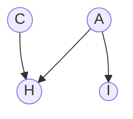
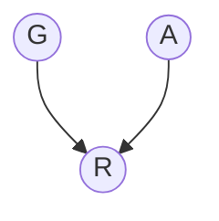
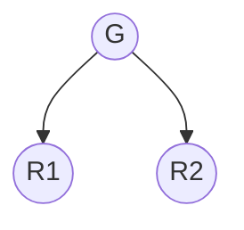

# Aprendizaje de redes bayesianas a partir de datos

> [!summary] Pregunta central
> Si conocemos la estructura de una red bayesiana, ¿cómo estimamos sus tablas de probabilidad condicional (CPT) con datos? ¿Qué cambia cuando faltan valores o cuando también desconocemos las flechas?

La sesión del **20 de octubre de 2026** trata el aprendizaje de redes bayesianas a partir de datos (clase 21 de la planeación en el [[Indice|índice]]). La nota es autocontenida: los conjuntos de datos, las tablas de conteos y los grafos de cada ejemplo se reproducen completos. En [[2026-10-15 IA - Muestreo en redes bayesianas|la clase anterior]] la red y sus CPT ya estaban dadas y queríamos responder consultas. Aquí usamos observaciones para **aprender el modelo**.

| Tema | Sección |
|---|---|
| Planteamiento y ejemplos con calificaciones | §§1–2 |
| Máxima verosimilitud y suavizado | §§2–3 |
| Datos incompletos y EM | §4 |
| Aprendizaje de estructura y otros enfoques | §§5–6 |

## 1. Qué se aprende de una red

Una red bayesiana contiene un **grafo acíclico dirigido** y una CPT por variable. Para $X_1,\ldots,X_n$:

$$
P_\theta(x_1,\ldots,x_n)=\prod_{i=1}^{n}P_\theta(x_i\mid\operatorname{Pa}(X_i)).
$$

El grafo determina qué variables son padres de cada nodo. Los **parámetros** $\theta$ son las probabilidades de las filas de las CPT. Cada ejemplo de entrenamiento es una asignación observada de variables; puede ser completa o parcial. Aprender parámetros mantiene fijo el grafo; aprender la estructura busca también las flechas.

Consideremos un grafo de cuatro variables binarias $C\to H\leftarrow A$ y $A\to I$, cuyas CPT son inicialmente desconocidas:

| CPT | Filas por estimar |
|---|---|
| $P(C)$ | 2: $P(C=1)$, $P(C=0)$ |
| $P(A)$ | 2: $P(A=1)$, $P(A=0)$ |
| $P(H\mid C,A)$ | 8: una por cada combinación $(c,a,h)\in\{0,1\}^3$ |
| $P(I\mid A)$ | 4: una por cada combinación $(a,i)\in\{0,1\}^2$ |

Todas las entradas son incógnitas (`?`). La ventaja de la factorización es que podemos estimar **distribuciones locales**, en vez de una tabla conjunta para todas las combinaciones.

## 2. Datos completos: contar y normalizar

Para una variable $X$ con padres $U=\operatorname{Pa}(X)$, definamos $N(x,u)$ como el número de ejemplos con $X=x$ y $U=u$, y $N(u)=\sum_xN(x,u)$. La estimación de **máxima verosimilitud** (MLE) de cada fila es:

$$
\boxed{\hat P_{\mathrm{ML}}(X=x\mid U=u)=\frac{N(x,u)}{N(u)}}\qquad\text{si }N(u)>0.
$$

La idea es elegir $\theta$ que maximiza $P(D_{\mathrm{train}}\mid\theta)$, o equivalentemente su logaritmo. Con ejemplos completos e independientes, la log-verosimilitud se separa en sumas por CPT y por configuración de padres; por eso basta contar y normalizar **dentro de cada fila**. Esta derivación justifica la regla de contar y normalizar que se aplica en las tablas de los ejemplos.

### 2.1 Una sola variable: calificaciones

Primer ejemplo: una variable $R\in\{1,2,3,4,5\}$ (calificación) y diez observaciones:

$$
D=\{1,3,4,4,4,4,4,5,5,5\}.
$$

| Calificación $r$ | 1 | 2 | 3 | 4 | 5 |
|---|---:|---:|---:|---:|---:|
| Conteo $N(r)$ | 1 | 0 | 1 | 5 | 3 |
| $\hat P_{\mathrm{ML}}(r)$ | 0.1 | 0 | 0.1 | 0.5 | 0.3 |

La suma de probabilidades es 1. El cero en la calificación 2 significa **«no apareció en esta muestra»**; no demuestra que sea imposible en la población.

### 2.2 Padres: una fila por género

Sea $G\in\{d=\text{drama},c=\text{comedia}\}$ con la flecha $G\to R$. Los datos son $(d,4),(d,4),(d,5),(c,1),(c,5)$. La conjunta queda $P(G,R)=P(G)P(R\mid G)$.

| Fila | Frecuencia estimada |
|---|---:|
| $P(G=d)$ | $3/5$ |
| $P(G=c)$ | $2/5$ |
| $P(R=4\mid G=d)$ | $2/3$ |
| $P(R=5\mid G=d)$ | $1/3$ |
| $P(R=1\mid G=c)$ | $1/2$ |
| $P(R=5\mid G=c)$ | $1/2$ |

Por ejemplo, consideremos la pregunta $P(R=2\mid G=c)$: **MLE da $0/2=0$**. Los dos ejemplos de comedia son el denominador correcto, no los cinco datos totales. Para una configuración de padres que nunca apareció, $N(u)=0$ y la regla $N(x,u)/N(u)$ queda indefinida: no debemos llamarla cero.

**Un segundo padre.** Añadamos una variable $A\in\{0,1\}$ («la película ganó un premio»), con $G\to R\leftarrow A$:

Con los registros $(g,a,r)$: $(d,0,1),(d,0,3),(d,1,5),(c,0,5),(c,1,4)$, las tablas de conteo y MLE son:

| $G$ | conteo | $P(G)$ | | $A$ | conteo | $P(A)$ |
|---|---:|---:|---|---|---:|---:|
| d | 3 | 3/5 | | 0 | 3 | 3/5 |
| c | 2 | 2/5 | | 1 | 2 | 2/5 |

| $g$ | $a$ | $r$ | conteo$(g,a,r)$ | $P(R=r\mid g,a)$ |
|---|---|---|---:|---:|
| d | 0 | 1 | 1 | 1/2 |
| d | 0 | 3 | 1 | 1/2 |
| d | 1 | 5 | 1 | 1 |
| c | 0 | 5 | 1 | 1 |
| c | 1 | 4 | 1 | 1 |

Ahora cada par $(g,a)$ necesita su propia fila $P(R\mid g,a)$; hay menos ejemplos por fila (la fila $(d,0)$ tiene dos registros y las demás uno).

**Dos hijos del mismo padre.** Sean $G\to R_1$ y $G\to R_2$ las calificaciones de John y Mary:

Con $D_{\mathrm{train}}=\{(d,4,5),(d,4,4),(d,5,3),(c,1,2),(c,5,4)\}$, donde cada registro es $(g,r_1,r_2)$, las CPT son:

| $g$ | conteo | $P(g)$ |
|---|---:|---:|
| d | 3 | 3/5 |
| c | 2 | 2/5 |

| $g$ | $r_1$ | conteo | $P(r_1\mid g)$ | | $g$ | $r_2$ | conteo | $P(r_2\mid g)$ |
|---|---|---:|---:|---|---|---|---:|---:|
| d | 4 | 2 | 2/3 | | d | 3 | 1 | 1/3 |
| d | 5 | 1 | 1/3 | | d | 4 | 1 | 1/3 |
| c | 1 | 1 | 1/2 | | d | 5 | 1 | 1/3 |
| c | 5 | 1 | 1/2 | | c | 2 | 1 | 1/2 |
| | | | | | c | 4 | 1 | 1/2 |

El mismo género alimenta dos CPT distintas. Una red con más padres puede expresar más patrones, pero también dispersa los datos entre más filas.

### 2.3 Compartir parámetros

Si imponemos que dos distribuciones condicionales usen los **mismos parámetros**, sus observaciones pueden combinarse para estimarlos. Por ejemplo, si se supone $P(R_1\mid G)=P(R_2\mid G)$, los conteos de John y Mary se agrupan por género antes de normalizar. Con los tres dramas del conjunto anterior (John: 4, 4, 5; Mary: 5, 4, 3), las seis calificaciones combinadas son $4,4,5,5,4,3$: la fila compartida daría $P(R=4\mid d)=3/6$.

Con los dos conjuntos de calificaciones (John y Mary) agrupados por género, la CPT compartida $P(R\mid g)$ queda así (la tabla $P(G)$ no cambia: $P(d)=3/5$, $P(c)=2/5$):

| $g$ | $r$ | conteo | $P(R=r\mid g)$ |
|---|---|---:|---:|
| d | 3 | 1 | 1/6 |
| d | 4 | 3 | 3/6 |
| d | 5 | 2 | 2/6 |
| c | 1 | 1 | 1/4 |
| c | 2 | 1 | 1/4 |
| c | 4 | 1 | 1/4 |
| c | 5 | 1 | 1/4 |

Las dos flechas $G\to R_1$ y $G\to R_2$ consultan esta misma tabla.

Compartir reduce la variabilidad cuando hay pocos datos, pero obliga a dos CPT a ser iguales aun si las preferencias reales difieren. **Es una restricción del modelo**, no una consecuencia automática de que $R_1$ y $R_2$ tengan el mismo dominio.

## 3. Suavizado de Laplace

Para evitar ceros debidos a muestras pequeñas, se agregan $\lambda$ observaciones ficticias **a cada valor** de una fila. Si $X$ tiene $k$ valores:

$$
\boxed{\hat P_{\lambda}(X=x\mid U=u)=\frac{N(x,u)+\lambda}{N(u)+k\lambda}},\qquad \lambda>0.
$$

En la fila de comedia hay $N(c)=2$ y $k=5$. Con $\lambda=1$:

$$
\hat P_1(R=2\mid G=c)=\frac{0+1}{2+5}=\frac17\approx0.143.
$$

El denominador suma **cinco** pseudoconteos, no uno. Si $N(u)=0$ y $\lambda>0$, la fila resulta uniforme: $1/k$. A medida que crecen las observaciones, el efecto relativo del suavizado disminuye. Un $\lambda$ demasiado grande empuja las filas hacia la uniforme e introduce sesgo.

### Explorar las filas de la CPT

<iframe src="ia17-estimacion-parametros.htm" style="width:100%;height:600px;border:1px solid var(--lightgray);border-radius:4px;" loading="lazy"></iframe>

El recurso parte de los cinco pares $(G,R)$ del ejemplo anterior. Cambia el género, los conteos o $\lambda$ y compara la MLE con la fila suavizada. Con $\lambda=0$, ambas coinciden; al aumentar $\lambda$, los valores ausentes reciben probabilidad positiva y la distribución se acerca a la uniforme. Si borras todos los conteos, la MLE queda indefinida.

## 4. Datos incompletos: la variable oculta ya no se puede contar

Consideremos $G\to R_1$ y $G\to R_2$ cuando observamos las dos calificaciones, pero **no** el género. Cada registro tiene la forma $(?,r_1,r_2)$; con los mismos datos de antes quedan $D_{\mathrm{train}}=\{(?,4,5),(?,4,4),(?,5,3),(?,1,2),(?,5,4)\}$. En la notación general, $H=G$ es la variable oculta, $E=(R_1,R_2)$ la evidencia observada y $\theta=(p_G,p_{R_1},p_{R_2})$ los parámetros. No sabemos a qué fila de $P(R_1\mid G)$ y $P(R_2\mid G)$ asignarlo. La verosimilitud de un par observado debe sumar sobre el género oculto:

$$
P_\theta(r_1,r_2)=\sum_{g\in\{d,c\}}P_\theta(g)P_\theta(r_1\mid g)P_\theta(r_2\mid g).
$$

Para todos los registros, se maximiza $\prod_j P_\theta(r_{1j},r_{2j})$, o la suma de sus logaritmos. El logaritmo de una **suma** mezcla los parámetros de las filas: ya no basta con asignar conteos enteros por observación. Este es el problema de **máxima verosimilitud marginal**, que se resuelve con el algoritmo siguiente.

### 4.1 Expectation–Maximization (EM)

EM alterna dos operaciones:

1. **E (esperanza):** con parámetros actuales $\theta^{(t)}$, calcular para cada registro la probabilidad de cada valor oculto, por ejemplo $w_{jg}=P_{\theta^{(t)}}(G=g\mid r_{1j},r_{2j})$. Son «conteos fraccionarios»; para cada registro, $\sum_g w_{jg}=1$.
2. **M (maximización):** volver a estimar las CPT con esos conteos ponderados. Así, $\hat P(G=g)=\sum_jw_{jg}/m$ y $\hat P(R_1=r\mid g)=\sum_{j:r_{1j}=r}w_{jg}/\sum_jw_{jg}$; análogamente para $R_2$.

Se inicializan los parámetros y se repite hasta que el cambio sea pequeño. Cada iteración exacta de EM **no disminuye** la verosimilitud de los datos observados, pero puede llegar a un máximo local; la inicialización importa. Si todos los géneros están ocultos, intercambiar las etiquetas $d$ y $c$ puede dar un modelo probabilísticamente equivalente: las etiquetas de componentes no son identificables solo a partir de esas parejas.

> [!important] Dos usos distintos de la inferencia
> En la clase de muestreo, inferíamos variables desconocidas para **responder una consulta** con un modelo fijo. En el paso E de EM, inferimos variables faltantes para **reestimar las CPT**. Ambos pueden usar cálculo de posteriores, pero persiguen objetivos distintos.

## 5. Si tampoco sabemos la estructura

El espacio de búsqueda son los grafos dirigidos **acíclicos** sobre las variables. Para cada candidato se ajustan sus parámetros y se evalúa qué tan bien explica los datos. Una búsqueda local puede agregar, quitar o invertir una flecha, siempre que el resultado siga siendo acíclico. Entre los métodos de búsqueda se encuentran ascenso de colinas, recocido simulado, algoritmos genéticos y búsqueda tabú.

La sola verosimilitud de entrenamiento suele favorecer redes cada vez más complejas: añadir padres permite más filas y puede acomodar mejor los datos vistos. Una puntuación sencilla que expresa la preferencia por parsimonia es

$$
S(G)=\max_\theta\log P(D_{\mathrm{train}}\mid G,\theta)-\rho\,C(G),\qquad\rho>0,
$$

donde $C(G)$ mide complejidad, por ejemplo el número de parámetros libres. Otra posibilidad es valorar predicción en datos no usados para ajustar el modelo. Un término de la forma $\rho\max|\operatorname{parents}|$ solo penaliza si entra con signo negativo y $\rho>0$; con signo positivo premiaría más padres, contrario al objetivo de evitar redes complejas. Por eso la expresión anterior muestra explícitamente una **penalización**.

## 6. Otros estimadores y límites de interpretación

La **máxima a posteriori** (MAP) combina los datos con una preferencia previa por parámetros: $\hat\theta_{\mathrm{MAP}}=\arg\max_\theta P(D\mid\theta)P(\theta)$. El **aprendizaje bayesiano** mantiene incertidumbre sobre $\theta$ y promedia predicciones sobre posibles parámetros. Ambos van más allá de estimar una única CPT por frecuencia.

La estructura aprendida desde observaciones representa dependencias estadísticas. Sus flechas no demuestran por sí solas causalidad: podrían existir variables no observadas o estructuras distintas que expliquen las mismas independencias. Esta precisión matiza el objetivo del aprendizaje de estructura.

## 7. Comprobaciones para estudiar

1. Con $D=\{1,3,4,4,4,4,4,5,5,5\}$, ¿cuánto valen $\hat P_{\mathrm{ML}}(R=2)$ y $\hat P_1(R=2)$?
   > [!check]- Respuesta
   > $0$ y $(0+1)/(10+5)=1/15$.
2. En la fila de comedia, ¿por qué $P(R=2\mid c)$ se divide entre 2 y no entre 5?
   > [!check]- Respuesta
   > La CPT condiciona en $G=c$; solo dos registros tienen ese género. El 5 es el total para estimar $P(G)$.
3. Si en $G\to R_1,R_2$ falta $G$, ¿qué se calcula antes de actualizar las CPT?
   > [!check]- Respuesta
   > Para cada registro, la posterior $P(G=g\mid r_1,r_2)$ bajo los parámetros actuales; sus probabilidades aportan conteos fraccionarios.
4. ¿Por qué conviene penalizar una estructura con muchos padres?
   > [!check]- Respuesta
   > Introduce más filas y parámetros, puede ajustar peculiaridades del conjunto de entrenamiento y deja menos observaciones por configuración de padres.

## Resumen después de clase

Con la estructura conocida y datos completos, cada fila de una CPT se aprende contando asignaciones locales y normalizando. Laplace añade pseudoconteos para evitar ceros frágiles. Con variables ocultas, EM alterna inferir sus posibles valores y reajustar las CPT con conteos ponderados. Si también se desconoce el grafo, se buscan estructuras acíclicas y se equilibra el ajuste a datos con la complejidad.

## Acciones de estudio

- [ ] Rehacer las tablas de conteos de los ejemplos (calificaciones, género y calificación, premio, John y Mary) a partir de sus registros.
- [ ] Calcular $P(R=2\mid G=c)$ con MLE y con $\lambda=0.5,1,2$; observar la tendencia en el recurso interactivo.
- [ ] Explicar con palabras qué es un conteo fraccionario del paso E de EM.
- [ ] Distinguir aprendizaje de parámetros, aprendizaje de estructura e inferencia con un modelo ya aprendido.
