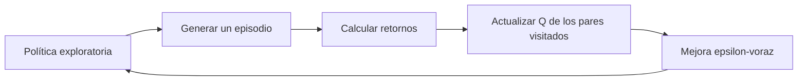

# Aprendizaje por refuerzo II: aprender de la experiencia y generalizar

> [!summary] Pregunta central
> Si nadie nos entrega las probabilidades del mundo ni las recompensas de cada decisión, ¿cómo aprendemos qué hacer y cómo aprovechamos lo aprendido en situaciones nuevas?

**Jueves 5 de noviembre de 2026.** Continuación de [[2026-11-03 IA - Aprendizaje por refuerzo|la clase del 3 de noviembre: MDP, Bellman y políticas]]. Este apunte desarrolla las **22 diapositivas** de «Clase 22: aprendizaje por refuerzo II»; la fecha de creación del PDF también corresponde al 5 de noviembre. La numeración del archivo es distinta de la numeración de sesiones del plan.

**Cómo leerlo.** Primero construiremos la intuición con episodios y puertas; después obtendremos las reglas de actualización; finalmente pasaremos de memorizar valores a compartir parámetros. Las derivaciones, los números de los ejercicios y los laboratorios son elaboración didáctica. Los ejemplos adaptados de Berkeley y las ampliaciones que no se desarrollan en las diapositivas se identifican explícitamente.

## Material de clase y recorrido

![[AI 22 Aprendizaje por refuerzo II.pdf]]

| Pregunta | Diapositivas | Sección |
|---|---:|---|
| ¿Qué cambia cuando no conocemos el modelo? | 1–5 | 1 |
| ¿Cómo evalúo una política con episodios? | 6 | 2–3 |
| ¿Por qué actuar siempre de forma voraz puede fallar? | 7–8 | 4 |
| ¿Cómo alterno evaluación y mejora con muestras? | 9 | 5 |
| ¿Puedo aprender una política distinta de la que sigo? | 10 | 6 |
| ¿Cómo se obtiene y ejecuta Q-learning? | 11–13 | 7–9 |
| ¿Qué hago si la tabla ya no cabe? | 14–16 | 10 |
| ¿Cómo conecta esto con Atari y los métodos profundos? | 17–19 | 11–12 |
| ¿Qué recursos y temas siguen? | 20–22 | 13 |

**Ruta sugerida:** calcular un retorno → promediar retornos → explorar → mejorar la política → sustituir una esperanza de Bellman por una muestra → compartir lo aprendido mediante características.

## 1. El salto respecto de la clase anterior: del modelo a las muestras

### 1.1 El problema sigue siendo un MDP

*Diapositivas 3–5.* Seguimos teniendo estados $s$, acciones $a$, transiciones $T(s,a,s')$ y recompensas $R(s,a,s')$. Buscamos una política que maximice el retorno esperado. La diferencia es **qué información recibe el agente**: ahora $T$, $R$ o ambos son desconocidos.

Mantendremos la convención temporal de la nota anterior:

$$
S_t\xrightarrow{A_t}\bigl(R_{t+1},S_{t+1}\bigr).
$$

Una muestra es $(s,a,r,s')$. El agente sabe qué hizo y qué ocurrió, pero una transición aislada no le revela todos los sucesores posibles ni sus probabilidades.

Recordemos tres objetos:

$$
G_t=R_{t+1}+\gamma R_{t+2}+\gamma^2R_{t+3}+\cdots,
$$

$$
V^\pi(s)=\mathbb E_\pi[G_t\mid S_t=s],\qquad
Q^\pi(s,a)=\mathbb E_\pi[G_t\mid S_t=s,A_t=a].
$$

En $Q^\pi$ fijamos la primera acción y seguimos $\pi$ después. Escribiremos $V,Q$ para nuestras **estimaciones** y $V^\pi,Q^\pi,Q^*$ para los valores que intentamos estimar; las diapositivas usan también letras minúsculas $v,q$.

### 1.2 Por qué la iteración de políticas necesita un reemplazo

La diapositiva 4 recupera el ciclo de programación dinámica:

1. **Evaluar** una política $\pi$ mediante el modelo.
2. **Mejorar** esa política comparando acciones.
3. Repetir hasta que la política sea estable.

Para evaluar una política determinista usábamos

$$
V^\pi(s)=\sum_{s'}T(s,\pi(s),s')
\left[R(s,\pi(s),s')+\gamma V^\pi(s')\right].
$$

Sin $T$ y $R$ no podemos calcular esa suma directamente. Las experiencias pueden reemplazar la información que falta de dos maneras:

| Camino | Qué aprendemos | Qué hacemos después |
|---|---|---|
| Basado en modelo (*model-based*) | $\widehat T$ y $\widehat R$ | Planificar con el modelo aprendido |
| Libre de modelo (*model-free*) | Valores o una política directamente | Decidir sin construir explícitamente $\widehat T,\widehat R$ |

Por ejemplo, observar tres veces $s'$ en cuatro intentos de $(s,a)$ da $\widehat T(s,a,s')=3/4$. Es una frecuencia estimada, no una probabilidad conocida con certeza. Este primer camino se desarrolla en [Berkeley CS 188, §5.2](https://inst.eecs.berkeley.edu/~cs188/textbook/rl/mbl.html). La clase se concentra en el segundo.

> [!note] Libre de modelo no significa libre de supuestos
> Seguimos necesitando estados adecuados, acciones, recompensas y una interacción compatible con el problema. Lo que evitamos es construir y consultar explícitamente un modelo de transición para actualizar los valores.

## 2. Monte Carlo: aprender cuánto vale una política observando cómo termina

*Diapositiva 6.* Imagina que sigues siempre la misma regla para atravesar un laberinto. Al terminar puedes preguntar: «desde aquella casilla, ¿cuánto premio acumulé?». Si repites suficientes episodios, el promedio de esas experiencias puede estimar lo que cabe esperar desde la casilla.

**Evaluación** significa que la política está fijada: de momento queremos saber cuánto vale, no decidir cómo cambiarla.

### 2.1 Un episodio proporciona retornos para varios instantes

Para un episodio que termina en $\tau$:

$$
S_0,A_0,R_1,S_1,A_1,R_2,\ldots,S_{\tau-1},A_{\tau-1},R_\tau,S_\tau.
$$

El retorno desde $t<\tau$ es

$$
\boxed{G_t=\sum_{k=0}^{\tau-t-1}\gamma^kR_{t+k+1}.}
$$

Se calcula cómodamente **hacia atrás**:

$$
G_\tau=0,\qquad G_t=R_{t+1}+\gamma G_{t+1}.
$$

**Ejemplo didáctico.** Con recompensas $[-1,-1,+10]$ y $\gamma=0.9$:

$$
\begin{aligned}
G_2&=10,\\
G_1&=-1+0.9(10)=8,\\
G_0&=-1+0.9(8)=6.2.
\end{aligned}
$$

La recompensa final aporta $0.9^2(10)=8.1$ al retorno inicial. El retorno no es solamente el premio final ni la recompensa inmediata.

### 2.2 De una esperanza desconocida a un promedio

Si reunimos $n$ retornos correspondientes a visitas de $s$ bajo una política fija:

$$
V_n(s)=\frac1n\sum_{i=1}^{n}G^{(i)}(s).
$$

El número $n$ cuenta **retornos usados para ese estado**, no todos los pasos ni todos los episodios. Un estado que no visitamos no recibe información nueva.

No hace falta almacenar todos los retornos. Separando el último término:

$$
\begin{aligned}
V_n(s)&=\frac{n-1}{n}V_{n-1}(s)+\frac1nG^{(n)}(s)\\
&=V_{n-1}(s)+\frac1n\left[G^{(n)}(s)-V_{n-1}(s)\right].
\end{aligned}
$$

Así aparece una estructura que volveremos a usar:

$$
\boxed{\text{estimación nueva}=\text{estimación anterior}+\alpha\,(\text{objetivo}-\text{estimación anterior}).}
$$

Con $\alpha_n=1/n$ obtenemos exactamente la media. Una $\alpha$ constante da más peso a experiencias recientes y **ya no es la media uniforme de todas las muestras**.

### 2.3 Primera visita y todas las visitas

Si un estado aparece varias veces en un episodio, debemos especificar qué retornos se usan:

| Variante | Retornos incorporados por episodio |
|---|---|
| Primera visita (*first-visit*) | El de la primera aparición de $s$ |
| Todas las visitas (*every-visit*) | Uno por cada aparición de $s$ |

**Ejemplo de revisitas.** $S\xrightarrow{+1}S\xrightarrow{+2}X$, con $X$ terminal y $\gamma=1$. Los retornos de las dos visitas a $S$ son $3$ y $2$. Tras este único episodio, primera visita produce $V(S)=3$; todas las visitas produce $V(S)=2.5$.

Los retornos de un mismo episodio pueden estar correlacionados. Ambas variantes pueden ser consistentes bajo condiciones apropiadas; no debemos interpretar dos visitas del mismo episodio como dos experimentos independientes.

### 2.4 Qué necesita Monte Carlo

Necesita **retornos completos** para la versión episódica estudiada aquí. Con política fija, suficientes visitas y retornos integrables, los promedios pueden aproximar $V^\pi$. Un descuento no hace que un episodio termine: en el automóvil de la clase anterior, Fast en Cool y Slow en Warm puede continuar indefinidamente.

Si cortamos artificialmente un episodio y ponemos continuación cero, estamos cambiando el objetivo por uno truncado. Para aprender en tareas continuas sin esperar al final, introduciremos TD en la sección 7.

## 3. Ejemplo de Berkeley: mismos sucesores, estimaciones diferentes

**Adaptación del ejemplo de evaluación directa de [CS 188, §5.3.1](https://inst.eecs.berkeley.edu/~cs188/textbook/rl/mfl.html).** Usamos $\gamma=1$ y episodios de tres transiciones. $X$ es terminal; las acciones de la política están fijadas. $B$ y $E$ llevan a $C$ con recompensa $-1$; desde $C$ se observa $D$ o $A$ con recompensa $-1$; salir de $D$ da $+10$ y de $A$ da $-10$.

La siguiente colección didáctica reproduce los conteos y promedios del ejemplo:

| Episodio | Estados | Recompensas | Retornos desde los estados no terminales |
|---:|---|---|---|
| 1 | $B\to C\to D\to X$ | $-1,-1,+10$ | $B:8$, $C:9$, $D:10$ |
| 2 | $E\to C\to A\to X$ | $-1,-1,-10$ | $E:-12$, $C:-11$, $A:-10$ |
| 3 | $E\to C\to D\to X$ | $-1,-1,+10$ | $E:8$, $C:9$, $D:10$ |
| 4 | $B\to C\to D\to X$ | $-1,-1,+10$ | $B:8$, $C:9$, $D:10$ |

Por ejemplo:

$$
V(C)=\frac{9-11+9+9}{4}=4,\qquad
V(E)=\frac{-12+8}{2}=-2,\qquad V(B)=8.
$$

**La intuición importante:** según la estructura descrita, $B$ y $E$ tienen el mismo sucesor y el mismo premio inmediato; sus valores verdaderos bajo esta política son iguales. Las estimaciones MC difieren porque las pocas trayectorias observadas tuvieron distinta suerte. Un promedio empírico no está obligado a satisfacer exactamente Bellman después de cuatro episodios.

### Laboratorio 1. Reconstruir el retorno y su promedio

<iframe src="ia22-monte-carlo.htm" style="width:100%;height:600px;border:1px solid var(--lightgray);border-radius:4px;" loading="lazy"></iframe>

**Idea central aunque el laboratorio no cargue:** cada visita aporta el retorno desde ese instante, y el promedio usa solamente los retornos seleccionados para ese estado.

1. Con $\gamma=1$, incorpora los cuatro episodios y comprueba $V(C)=4$, $V(B)=8$, $V(E)=-2$.
2. Cambia a $\gamma=0.9$: el primer episodio debe dar $6.2,8,10$.
3. Selecciona el ejemplo de revisitas y compara primera visita con todas las visitas. El resultado inicial debe ser $3$ frente a $2.5$ con $\gamma=1$.

## 4. Las dos puertas: estimar bien requiere explorar

### 4.1 El problema de confiar demasiado pronto

*Diapositiva 7.* Abrimos la izquierda una vez y recibimos $0$. Después abrimos la derecha y recibimos $1$, $3$, $2$. Sus medias son

$$
\widehat Q(\text{izquierda})=0,\qquad
\widehat Q(\text{derecha})=\frac{1+3+2}{3}=2.
$$

Si elegimos siempre la mayor estimación, volveremos a la derecha. Pero **no sabemos cuál puerta tiene mayor recompensa esperada**: una observación de la izquierda no determina su distribución.

Aunque la diapositiva escribe $v(\text{left})$, aquí usaremos $Q(s,\text{izquierda})$: estamos comparando acciones desde una misma situación. Como cada intento termina tras una recompensa, este ejemplo es un **bandido de dos brazos**, un caso de decisión de un solo paso.

**Contraejemplo didáctico, no distribución revelada por el PDF:** la izquierda da $10$ con probabilidad $0.4$ y $0$ con $0.6$; la derecha da $1,2,3$ equiprobablemente. Entonces sus medias verdaderas son $4$ y $2$. La secuencia de la diapositiva es compatible con que la izquierda sea mejor. Explotar de inmediato puede atraparnos en una conclusión equivocada.

### 4.2 Construir la política $\varepsilon$-voraz

*Diapositiva 8.* Combinamos dos decisiones:

1. Con probabilidad $1-\varepsilon$, elegir una acción codiciosa según $Q$.
2. Con probabilidad $\varepsilon$, elegir uniformemente entre **todas** las acciones legales.

Si hay $m$ acciones y un máximo único $a^*$:

$$
\mu(a\mid s)=
\begin{cases}
1-\varepsilon+\varepsilon/m,&a=a^*,\\
\varepsilon/m,&a\ne a^*.
\end{cases}
$$

La mejor acción también puede salir sorteada al explorar. Con dos acciones y $\varepsilon=0.2$, sus probabilidades son $0.9$ y $0.1$, no $0.8$ y $0.2$.

Para resolver empates de forma simétrica, sea $\mathcal G(s)=\arg\max_a Q(s,a)$:

$$
\boxed{\mu(a\mid s)=\frac{\varepsilon}{m}
+(1-\varepsilon)\frac{\mathbf1\{a\in\mathcal G(s)\}}{|\mathcal G(s)|}.}
$$

La suma de probabilidades es $\varepsilon+(1-\varepsilon)=1$. Con todos los valores empatados, esta regla es uniforme incluso si $\varepsilon=0$.

### 4.3 Separar tres parámetros

| Parámetro | Pregunta que responde | Qué ocurre al aumentarlo |
|---|---|---|
| $\gamma$ | ¿Cuánto pesa el futuro en el objetivo? | Pesan más las consecuencias lejanas |
| $\alpha$ | ¿Cuánto cambia una estimación con una muestra? | La corrección es mayor |
| $\varepsilon$ | ¿Con qué frecuencia se elige al azar? | Se actúa más veces por exploración |

Explorar puede reducir el premio inmediato para obtener información útil. La probabilidad positiva de cada acción **en un estado visitado** no garantiza por sí sola visitar todos los estados. Deben existir formas de alcanzarlos y suficientes oportunidades de hacerlo. Véase [CS 188, §5.4](https://inst.eecs.berkeley.edu/~cs188/textbook/rl/eae.html).

### Laboratorio 2. Una mala primera impresión de la puerta izquierda

<iframe src="ia22-puertas-exploracion.htm" style="width:100%;height:600px;border:1px solid var(--lightgray);border-radius:4px;" loading="lazy"></iframe>

**Idea central:** el laboratorio empieza con las cuatro observaciones de la diapositiva y añade las distribuciones didácticas anteriores. El agente recibe muestras; los valores verdaderos se muestran únicamente para que podamos evaluar el experimento.

1. Con $\varepsilon=0$, ejecuta 200 intentos: la izquierda queda en una sola visita y estimación cero.
2. Reinicia con $\varepsilon=0.2$. Observa si las visitas permiten corregir esa estimación.
3. Repite con otra semilla: una ejecución corta no garantiza descubrir la mejor puerta. Compara las **visitas** además de los valores.

## 5. Control Monte Carlo: evaluar y mejorar con episodios

*Diapositiva 9.* La evaluación de estados contesta cuánto vale seguir una regla. Para elegir acciones sin consultar $T$ y $R$, conviene aprender directamente los valores de **pares estado–acción**:

$$
Q(s,a)\approx Q^\pi(s,a)=\mathbb E_\pi[G_t\mid S_t=s,A_t=a].
$$

Sustituimos el ciclo de la diapositiva 4 por uno basado en experiencia:



### 5.1 Procedimiento, sin omitir qué se cuenta

```text
Inicializar Q(s,a) y N(s,a)=0
Repetir por episodios:
    Generar un episodio con la política epsilon-voraz actual
    Mantener esa política fija durante el episodio
    Calcular todos los retornos hacia atrás
    Para cada par (s,a), usar su primera visita en el episodio:
        N(s,a) ← N(s,a)+1
        Q(s,a) ← Q(s,a) + [G - Q(s,a)] / N(s,a)
    Actualizar la política para hacerla epsilon-voraz respecto de Q
```

La **primera visita de un par** puede ser distinta de la primera visita de su estado. Si calculamos retornos recorriendo el episodio hacia atrás, debemos comprobar que no hubo una aparición **anterior** del par; tomar el primer encuentro en el recorrido inverso seleccionaría la última visita del episodio.

### 5.2 Por qué esto es control y qué no garantiza una ejecución corta

Al cambiar $Q$, cambia la política que generará los episodios posteriores. Estamos evaluando y mejorando de forma intercalada, sin esperar a resolver exactamente cada política. Es una forma de **iteración generalizada de políticas**.

Como las políticas cambian, la media acumulada puede mezclar retornos de comportamientos anteriores: durante el aprendizaje no debemos afirmar que cada tabla intermedia es la evaluación exacta de la política actual.

Con $\varepsilon>0$ fijo la política conserva exploración; no se convierte en una política determinista óptima sin restricciones. Para resultados asintóticos de control MC suelen imponerse condiciones como exploración infinita y comportamiento codicioso en el límite (**GLIE**), además de los supuestos episódicos y de estimación. Disminuir $\varepsilon$ demasiado rápido puede impedir la exploración necesaria. Esta precisión amplía el esquema de la diapositiva 9.

## 6. Dos políticas: la que produce los datos y la que queremos aprender

*Diapositiva 10.* Hasta ahora aprendíamos sobre el comportamiento que seguíamos. También podemos distinguir:

| Política | Papel |
|---|---|
| $\mu(a\mid s)$, de comportamiento | Elige las acciones reales y produce los datos |
| $\pi(a\mid s)$, objetivo | Es la política cuyo valor queremos estimar o mejorar |

**En política (*on-policy*):** evaluamos o mejoramos el comportamiento que genera la experiencia. **Fuera de política (*off-policy*):** el objetivo de aprendizaje puede corresponder a un comportamiento distinto del que genera las muestras.

Ejemplo: $\mu$ puede ser $\varepsilon$-voraz para investigar acciones; $\pi$ puede ser codiciosa para representar cómo actuaríamos al aprovechar lo aprendido.

### 6.1 Por qué no basta con cambiar la etiqueta de los datos

Los retornos completos obtenidos siguiendo $\mu$ reflejan las decisiones futuras de $\mu$. Si simplemente los promediamos, en general estimamos $Q^\mu$, no $Q^\pi$. La evaluación Monte Carlo fuera de política necesita un tratamiento adicional, como ponderar trayectorias por razones de probabilidades (*importance sampling*); la clase no desarrolla ese algoritmo.

Q-learning construirá otro tipo de objetivo: usa la transición real observada, pero evalúa una **continuación codiciosa**. Puede hacerlo porque, dado $(s,a)$, la distribución de la siguiente recompensa y estado pertenece al entorno, no a la política que eligió $a$.

> [!note] Reutilización y cobertura
> Se puede aprovechar experiencia de políticas anteriores, humanos u otros agentes, como indica la diapositiva. Aun así, los datos deben corresponder al problema y cubrir las decisiones relevantes. Aprender fuera de política no permite descubrir una acción jamás observada sin supuestos adicionales; tampoco resuelve automáticamente los problemas de aprendizaje con un conjunto fijo de datos y aproximadores.

## 7. De Bellman a Q-learning, paso a paso

*Diapositivas 11–13.* Esta sección desarrolla la actualización que la presentación introduce directamente. TD(0) y SARSA se usan como **puentes explicativos**; no son un bloque nuevo impartido en el PDF.

### 7.1 Primer puente: una muestra puede reemplazar un promedio

Para una política fija, Bellman expresa

$$
V^\pi(s)=\mathbb E_\pi[R_{t+1}+\gamma V^\pi(S_{t+1})\mid S_t=s].
$$

La transición observada proporciona un objetivo muestral

$$
y_t=R_{t+1}+\gamma V(S_{t+1}).
$$

Es una estimación del presente que usa nuestra estimación del futuro. Esta idea se llama **bootstrapping**. Aplicando la regla de corrección:

$$
\underbrace{\delta_t}_{\text{error TD}}=R_{t+1}+\gamma V(S_{t+1})-V(S_t),
$$

$$
\boxed{V(S_t)\leftarrow V(S_t)+\alpha_t\delta_t.}
$$

Es **TD(0)**: aprendemos después de una transición, sin esperar a conocer el retorno completo. El objetivo es ruidoso y usa valores todavía imperfectos; una actualización no tiene por qué mejorar la estimación real.

### 7.2 Segundo puente: aprender directamente valores de acciones

Para extraer acciones desde $V$ necesitamos comparar consecuencias usando un modelo. Aprender $Q$ permite comparar directamente $Q(s,a)$ para las acciones disponibles.

Si tomamos una acción sucesora real $A_{t+1}$ y la usamos en el objetivo:

$$
y_t^{\mathrm{SARSA}}=R_{t+1}+\gamma Q(S_{t+1},A_{t+1}).
$$

La actualización SARSA usa **S**tate, **A**ction, **R**eward, **S**tate, **A**ction. Si la acción sucesora procede de la misma política de comportamiento, aprende sobre esa continuación exploratoria: es el ejemplo típico de control en política.

### 7.3 Tercer puente: cambiar la continuación por la mejor estimada

La ecuación de optimalidad para acciones es

$$
Q^*(s,a)=\mathbb E\!\left[R_{t+1}+\gamma\max_{a'}Q^*(S_{t+1},a')\mid S_t=s,A_t=a\right].
$$

En el caso de modelo conocido, desarrollaríamos esa esperanza como una suma con $T$. Con experiencia, mantenemos los valores actuales $Q_t$ y tomamos una muestra:

$$
y_t^{Q}=R_{t+1}+\gamma\max_{a'\in\mathcal A(S_{t+1})}Q_t(S_{t+1},a').
$$

El error y la actualización son

$$
\delta_t=y_t^{Q}-Q_t(S_t,A_t),
$$

$$
\boxed{Q_{t+1}(S_t,A_t)=Q_t(S_t,A_t)+\alpha_t\left[
R_{t+1}+\gamma\max_{a'}Q_t(S_{t+1},a')-Q_t(S_t,A_t)\right].}
$$

**Solo cambia la entrada visitada.** Los otros pares conservan su valor. La política $\mu$ puede seleccionar $A_t$ explorando; el máximo del objetivo corresponde a una política objetivo codiciosa $\pi$. No necesitamos ejecutar la acción maximizadora del sucesor para calcular ese máximo en nuestra tabla.

Para una tabla $Q_t$ fija al calcular el objetivo, la esperanza condicional de $y_t^Q$ es precisamente el respaldo de optimalidad aplicado a $Q_t$. Por eso la actualización puede verse como una aproximación estocástica a Bellman. El máximo está **dentro** de la esperanza: la mejor acción de continuación se elige tras observar el estado sucesor.

### 7.4 Dos precisiones necesarias para leer las diapositivas

> [!warning] Diapositiva 11: la acción sucesora se elige en el sucesor
> La línea que presenta $A'$ escribe $S_t$, pero el objetivo usa $Q(S_{t+1},A')$. La distribución correcta para esa acción es $A'\sim\pi(\cdot\mid S_{t+1})$. Una continuación bajo una política objetivo arbitraria no es todavía el Q-learning de control óptimo; las diapositivas 12–13 lo especializan a la política codiciosa.

> [!warning] Diapositiva 12: máximo y argmáximo tienen tipos distintos
> La última igualdad debe contener $\max$, no $\arg\max$:
> $$
> Q\!\left(s',\operatorname*{arg\,max}_{a'}Q(s',a')\right)=\max_{a'}Q(s',a').
> $$
> Aquí elegimos una acción del conjunto de argmáximos. El argmáximo devuelve una **acción**; el máximo devuelve un **valor numérico**, que sí puede sumarse a una recompensa. La diapositiva 13 utiliza correctamente el máximo.

### 7.5 Una actualización numérica completa

**Ejemplo didáctico.** Supón $Q(s,a)=3$, recompensa $r=1$, valores sucesores $[4,2]$, descuento $\gamma=0.9$ y tasa $\alpha=0.2$:

$$
\begin{aligned}
\text{continuación}&=\max(4,2)=4,\\
y&=1+0.9(4)=4.6,\\
\delta&=4.6-3=1.6,\\
Q_{\mathrm{nuevo}}(s,a)&=3+0.2(1.6)=3.32.
\end{aligned}
$$

La actualización equivale a $(1-\alpha)3+\alpha(4.6)$. Nos acercamos al objetivo sin adoptarlo completamente.

Ahora supón que por exploración realmente tomaremos la segunda acción del sucesor, cuyo valor es $2$. SARSA usaría $1+0.9(2)=2.8$ y actualizaría a $2.96$. Q-learning conserva $3.32$: aprende sobre la continuación codiciosa aunque la conducta real explore.

### 7.6 El terminal aporta cero continuación

Si la transición termina el episodio, definimos

$$
y_t=R_{t+1},
$$

sin maximizar sobre un conjunto vacío de acciones. La recompensa de salida ya se cobró en la transición: no se suma otra vez como valor terminal.

Un corte por límite de tiempo **no siempre es un terminal del MDP**. Si solo interrumpimos una tarea que continúa, puede corresponder conservar el término de continuación. Si el objetivo tiene un horizonte finito real, el tiempo restante debe formar parte del estado o de los índices del valor.

## 8. Cómo se propaga una recompensa lejana

No hace falta recibir una recompensa en cada estado para aprender que es útil. Hace falta que las actualizaciones vayan transmitiendo el valor de los sucesores.

**Cadena didáctica determinista:** $S\xrightarrow{0}B\xrightarrow{10}X$, una única acción por estado, $X$ terminal, $\gamma=0.9$, $\alpha=0.5$ y $Q_0=0$. Repetimos el episodio y actualizamos en orden hacia adelante:

| Episodio completado | $Q(S,\text{ir})$ | $Q(B,\text{salir})$ | Qué ocurrió |
|---:|---:|---:|---|
| 0 | 0 | 0 | Sin experiencias |
| 1 | 0 | 5 | S todavía vio un sucesor de valor cero |
| 2 | 2.25 | 7.5 | S incorpora $0.9\times5$ con tasa $0.5$ |
| 3 | 4.5 | 8.75 | S usa el nuevo valor de B del episodio anterior |
| Límite de esta cadena | 9 | 10 | Valores exactos |

Por ejemplo, en la primera transición del segundo episodio:

$$
Q(S,\text{ir})\leftarrow0+0.5\,[0+0.9(5)-0]=2.25.
$$

Al terminar ese episodio, $Q(B,\text{salir})$ pasa de $5$ a $7.5$. La actualización previa de $S$ no se rehace automáticamente. Reproducir experiencias guardadas podría acelerar esa propagación; conectaremos esto con *replay* en la sección 11.

### Laboratorio 3. Q-learning sobre el automóvil de la clase anterior

Reutilizamos el laboratorio ya construido para el [[2026-11-03 IA - Aprendizaje por refuerzo#11. Complemento Berkeley: del modelo conocido a aprender de muestras|complemento preparatorio del 3 de noviembre]]:

<iframe src="ia21-lab-qlearning.htm" style="width:100%;height:600px;border:1px solid var(--lightgray);border-radius:4px;" loading="lazy"></iframe>

**Idea central:** el simulador usa el modelo del automóvil para producir transiciones; el agente que actualiza la tabla recibe solo $(s,a,r,s')$.

1. Con $\alpha=0.5$, $\gamma=0.9$ y $Q=0$, tomar Fast desde Cool da $r=2$ y actualiza $Q(C,\text{Fast})$ a $1$.
2. Al llegar a Warm, tomar Fast produce un terminal: $y=-10$ y la entrada inicialmente cero pasa a $-5$.
3. Reinicia y compara lotes con $\varepsilon=0$ y $0.2$. Revisa tanto Q como las visitas. Cambiar los parámetros reinicia el aprendizaje.

El laboratorio usa tasa constante y reinicios de práctica; sus trayectorias ilustran la actualización y no certifican la convergencia asintótica.

## 9. Algoritmo y alcance de la convergencia

### 9.1 Pseudocódigo tabular

*Diapositiva 13; versión desarrollada.*

```text
Inicializar Q(s,a) con valores finitos para cada par legal
Repetir por episodios:
    s ← estado inicial
    Mientras s no sea terminal:
        a ← acción epsilon-voraz respecto de Q(s,·)
        Ejecutar a y observar recompensa r, sucesor s' y terminación
        Si s' es terminal:
            y ← r
        Si no:
            y ← r + gamma * máximo_{a' legal en s'} Q(s',a')
        Q(s,a) ← Q(s,a) + alpha(s,a) * [y - Q(s,a)]
        s ← s'
```

Después del aprendizaje, una política de aprovechamiento es

$$
\pi_Q(s)\in\operatorname*{arg\,max}_{a\in\mathcal A(s)}Q(s,a).
$$

Extraer la política no requiere conocer $T$ ni $R$. Para evaluar el desempeño de esa política sin seguir entrenándola, se congelan las actualizaciones y se desactiva la exploración explícita; los empates aún pueden resolverse aleatoriamente.

### 9.2 Qué supuestos acompañan al teorema

La diapositiva afirma convergencia a $q^*$ «en el límite». Una formulación clásica suficiente para el caso descontado requiere:

- MDP estacionario con conjuntos finitos de estados y acciones, recompensas acotadas y $0\leq\gamma<1$.
- Representación **tabular** y observaciones válidas de las transiciones del MDP.
- Cada par estado–acción relevante actualizado infinitas veces.
- Para las tasas de las sucesivas visitas $n$ a cada par:

$$
\sum_{n=1}^{\infty}\alpha_n(s,a)=\infty,\qquad
\sum_{n=1}^{\infty}\alpha_n(s,a)^2<\infty.
$$

Por ejemplo, $\alpha_n=1/n$ cumple ambas condiciones. La primera evita congelar prematuramente la estimación; la segunda permite amortiguar el ruido. Bajo esos supuestos, $Q_t\to Q^*$ con probabilidad uno. Véase la fuente original: [Watkins y Dayan, «Q-learning», 1992](https://www.gatsby.ucl.ac.uk/~dayan/papers/cjch.pdf).

Una tasa constante no satisface la segunda suma; puede funcionar bien en experimentos e incluso converger en casos particulares deterministas, como la cadena anterior, sin heredar la garantía general. Tampoco basta decir «$\varepsilon>0$» si algunos estados nunca se alcanzan.

### 9.3 Comparar los objetivos que hemos construido

| Método | Objetivo de actualización | ¿Espera el final? | ¿Usa otro valor estimado en el objetivo? |
|---|---|---|---|
| Monte Carlo episódico | $G_t$ observado completo | Sí | No |
| TD(0), evaluación de $V$ | $r+\gamma V(s')$ | No | Sí |
| SARSA | $r+\gamma Q(s',a'_{\mathrm{real}})$ | No | Sí |
| Q-learning | $r+\gamma\max_{a'}Q(s',a')$ | No | Sí |

Los últimos tres usan bootstrapping. En terminales se elimina la continuación. Monte Carlo y TD son familias más amplias; la tabla compara las versiones concretas estudiadas aquí.

## 10. Cuando memorizar cada situación deja de ser posible

### 10.1 Dos límites de la tabla

*Diapositivas 14–16.* La presentación usa como órdenes de magnitud $10^{20}$ estados para backgammon y $10^{170}$ para Go; el control de un helicóptero introduce estados continuos. Su función es motivar la escala, no proporcionar conteos exactos universales.

Una tabla de Q requiere una entrada por cada par: aproximadamente $|\mathcal S||\mathcal A|$ números si todas las acciones están disponibles. Esto plantea dos problemas distintos:

1. **Memoria:** no caben todas las entradas.
2. **Experiencia:** aunque cupieran, no alcanzaríamos a visitar cada una suficientes veces.

Aprender que una posición de Pacman es peligrosa no informa a una tabla sobre otra posición casi idéntica. Necesitamos una representación que permita compartir experiencia.

### 10.2 De una entrada por par a una función con parámetros

Reemplazamos la tabla por

$$
\widehat V(s;w)\approx V^\pi(s),\qquad
\widehat Q(s,a;w)\approx Q^\pi(s,a).
$$

En control también podemos intentar aproximar $Q^*$. El objetivo concreto depende del algoritmo: la sola forma $\widehat Q(s,a;w)$ no indica qué política estamos evaluando.

Los mismos parámetros $w$ intervienen en muchos estados. Una actualización puede afectar situaciones no visitadas: eso es **generalización**. Que el efecto sea útil depende de la representación y de los datos.

### 10.3 Empezar por un aproximador lineal

Elegimos características $\phi_i(s,a)$ que describen aspectos útiles de la decisión:

$$
\phi(s,a)=\begin{pmatrix}\phi_0(s,a)\\\phi_1(s,a)\\\vdots\\\phi_d(s,a)\end{pmatrix},\qquad
\widehat Q(s,a;w)=w^\top\phi(s,a)=\sum_{i=0}^{d}w_i\phi_i(s,a).
$$

Una característica constante $\phi_0=1$ permite un sesgo. Las otras pueden describir alimento, fantasmas o distancias. Esta idea conecta con [[2026-10-22 IA - Introducción al ML|regresión]] y [[2026-10-27 IA - Aprendizaje supervisado y clasificacion|clasificación y redes neuronales]]: lo nuevo es que el objetivo de entrenamiento proviene de recompensas y de la propia estimación de continuación.

**Mini-Pacman didáctico**, inspirado en la representación por características de Berkeley:

$$
\phi(s,a)=(1,\ \text{come alimento},\ \text{queda junto a un fantasma}).
$$

Con $w=(0,2,-3)$:

| Situación y acción | Características | $\widehat Q$ |
|---|---|---:|
| A: comer sin peligro | $(1,1,0)$ | 2 |
| B: otra posición, comer sin peligro | $(1,1,0)$ | 2 |
| C: no comer y quedar en peligro | $(1,0,1)$ | −3 |
| D: comer y quedar en peligro | $(1,1,1)$ | −1 |

A y B comparten predicción aunque el tablero sea distinto. También revela una limitación: si una diferencia importante no aparece en las características, el aproximador no podrá distinguirla.

### 10.4 Derivar una actualización de pesos

**Ampliación de las diapositivas 15–16.** Construimos el objetivo Q-learning con los valores anteriores a la actualización:

$$
y=r+\gamma\max_{a'}\widehat Q(s',a';w),\qquad
\delta=y-\widehat Q(s,a;w).
$$

Para esta actualización tratamos $y$ como un número fijo y usamos

$$
L(w)=\frac12\left[y-\widehat Q(s,a;w)\right]^2.
$$

Entonces

$$
\nabla_w L=-\delta\,\nabla_w\widehat Q(s,a;w),\qquad
\boxed{w\leftarrow w+\alpha\delta\,\nabla_w\widehat Q(s,a;w).}
$$

Para el caso lineal, $\nabla_w\widehat Q=\phi$, por lo que

$$
\boxed{w_i\leftarrow w_i+\alpha\delta\phi_i(s,a).}
$$

Se llama **semigradiente** porque no derivamos el objetivo a través de su dependencia de los pesos. Por eso esta regla no equivale a descender el gradiente completo de un error de Bellman con ambos lados variables.

**Un paso a mano.** Para A, supongamos una transición terminal con $r=5$: $y=5$, predicción $2$, $\delta=3$ y $\alpha=0.1$:

$$
w'=(0,2,-3)+0.1(3)(1,1,0)=(0.3,2.3,-3).
$$

Las predicciones pasan a $2.6,2.6,-2.7,-0.4$. B cambia sin haber sido entrenado; C también cambia por el sesgo compartido. En la versión tabular, solo la entrada A cambiaría de $2$ a $2.3$ con esos mismos $\alpha$ y $\delta$.

### Laboratorio 4. Ver cómo una actualización afecta estados no visitados

<iframe src="ia22-generalizacion.htm" style="width:100%;height:600px;border:1px solid var(--lightgray);border-radius:4px;" loading="lazy"></iframe>

**Idea central:** una tabla modifica una entrada; un aproximador modifica parámetros que intervienen en muchas predicciones.

1. Con los valores iniciales y objetivo terminal $5$, actualiza A una vez. Comprueba $w'=(0.3,2.3,-3)$ y las cuatro predicciones anteriores.
2. Compara con la tabla: B conserva su valor inicial.
3. Entrena B con un objetivo distinto. A y B siguen siendo indistinguibles para el aproximador porque tienen las mismas características. Compartir información también puede producir interferencia.

## 11. De características a redes neuronales: qué añade DQN

*Diapositiva 17 y complemento para la próxima clase.* El artículo mostrado es [Mnih y colaboradores, «Human-level control through deep reinforcement learning», Nature, 2015](https://deepmind-media.storage.googleapis.com/dqn/DQNNaturePaper.pdf). Sustituye una tabla de acciones por una red que aproxima sus valores usando observaciones visuales de juegos Atari.

La idea de valor conserva su significado: una salida estima retorno esperado para una acción. Las salidas de una red Q **no tienen que ser probabilidades ni sumar uno**. Una arquitectura puede recibir $(s,a)$ y devolver un escalar, o recibir $s$ y devolver un valor por acción, como ilustra la diapositiva 16.

El problema no se resuelve únicamente sustituyendo $w^\top\phi$ por una red más grande. El objetivo depende de una estimación que cambia; además, las experiencias consecutivas están correlacionadas. DQN introduce dos mecanismos:

- **Memoria de experiencias (*experience replay*):** guardar transiciones y entrenar con muestras de esa memoria.
- **Red objetivo (*target network*):** usar parámetros $w^-$ que se mantienen fijos durante un intervalo para construir los objetivos.

Una expresión simplificada es

$$
y=r+\gamma(1-d)\max_{a'}Q(s',a';w^-),\qquad
L(w)=\mathbb E_{(s,a,r,s',d)\sim\mathcal D}\left[\left(y-Q(s,a;w)\right)^2\right],
$$

donde $d=1$ indica un terminal real y $\mathcal D$ es la memoria. No se deriva $y$ al actualizar la red principal.

La lección de Berkeley [CS 185/285, «Q-Learning in Practice», pp. 3–7 y 30–36 del PDF](https://rail.eecs.berkeley.edu/deeprlcourse/static/slides/lec-8.pdf) explica estos mecanismos y por qué la garantía tabular **no se traslada automáticamente** a aproximadores. Combinar aproximación, bootstrapping y aprendizaje fuera de política puede ser inestable. Este bloque prepara redes profundas; el PDF de nuestra clase solo muestra el artículo y la motivación.

## 12. Leer la taxonomía como varias preguntas independientes

*Diapositivas 18–19.* La diapositiva 18 es una transición de cierre. La figura de la 19 reúne familias de métodos. Es más útil leerla mediante varios ejes que intentar memorizarla como un único árbol:

| Eje | Pregunta | Ejemplos |
|---|---|---|
| Con modelo / libre de modelo | ¿Construimos o consultamos un modelo del entorno para aprender o planificar? | Modelo aprendido y planificación / Q-learning |
| Predicción / control | ¿Evaluamos una política o aprendemos a actuar mejor? | MC de $V^\pi$ / control MC |
| En política / fuera de política | ¿La política objetivo coincide con la que produce los datos? | SARSA / Q-learning |
| Tabular / aproximado | ¿Una entrada por par o parámetros compartidos? | Q tabular / Q lineal o profundo |
| Basado en valores / política parametrizada / actor-crítico | ¿Qué representamos para decidir? | Q / una política $\pi_\theta$ / política y valor |

**Profundo** describe el uso de redes profundas, no decide por sí solo los otros ejes. Puede haber modelos del entorno profundos, políticas profundas o valores profundos. Asimismo, «libre de modelo» no significa «sin gradientes»: el Q-learning aproximado puede actualizar pesos mediante semigradientes aunque no diferencie directamente el retorno de una política.

Esta lectura por componentes conecta con [Berkeley CS 185/285, «Reinforcement Learning Basics», pp. 18 y 28–39 del PDF](https://rail.eecs.berkeley.edu/deeprlcourse/static/slides/lec-4.pdf): generar muestras, estimar y mejorar son partes que pueden combinarse de distintas maneras. Los algoritmos avanzados de la figura quedan como orientación, no como contenido ya desarrollado en clase.

## 13. Herramientas de Berkeley para practicar lo que acabamos de derivar

Las notas anteriores usan **CS 188** para la base de IA. La diapositiva 20 también enlaza el curso de refuerzo profundo de Berkeley, cuya página consultada se presenta como **CS 185/285**. Ambos sirven en niveles distintos.

### 13.1 Gridworld, Crawler y Pacman: práctica progresiva

El [Proyecto 3 de CS 188, otoño de 2026](https://inst.eecs.berkeley.edu/~cs188/fa26/projects/proj3/) permite probar Q-learning y exploración en Gridworld, transferir el mismo agente a Crawler y pasar a características en Pacman. Es **práctica opcional externa**, no una tarea asignada por esta clase.

Una vez descargado y preparado el código oficial, desde su carpeta:

```bash
# Q-learning con decisiones manuales: observar qué entrada se actualiza.
python gridworld.py -a q -k 5 -m

# Comparar exploración baja y alta sin ruido de transición.
python gridworld.py -a q -k 100 --noise 0.0 -e 0.1
python gridworld.py -a q -k 100 --noise 0.0 -e 0.9

# Probar el mismo Q-learner en otro entorno.
python crawler.py
```

**Qué observar:** Q se actualiza para el estado que acabamos de dejar; la exploración puede seguir perjudicando el retorno aunque ya existan valores útiles; un agente general debe consultar las acciones legales del entorno. El proyecto continúa con aproximación en `qlearningAgents.py` y extractores en `featureExtractors.py`. Los comandos son una ruta de práctica documentada; no se han ejecutado ni instalado aquí.

### 13.2 Ruta de lectura y procedencia

Fuentes oficiales consultadas el **16 de noviembre de 2026**:

| Material | Uso en este apunte |
|---|---|
| Carlos Hernández, [[AI 22 Aprendizaje por refuerzo II.pdf|Clase 22: aprendizaje por refuerzo II]], 22 diapositivas | Material principal; orden de temas, puertas, control MC, Q-learning y escala |
| [CS 188, §5.2 — Model-Based Learning](https://inst.eecs.berkeley.edu/~cs188/textbook/rl/mbl.html) | Alternativa de aprender un modelo mediante conteos |
| [CS 188, §5.3 — Model-Free Learning](https://inst.eecs.berkeley.edu/~cs188/textbook/rl/mfl.html) | Ejemplo de evaluación directa y puente hacia TD, Q y características |
| [CS 188, §5.4 — Exploration and Exploitation](https://inst.eecs.berkeley.edu/~cs188/textbook/rl/eae.html) | Compromiso entre información y aprovechamiento |
| [CS 188, Proyecto 3](https://inst.eecs.berkeley.edu/~cs188/fa26/projects/proj3/) | Herramientas y comandos de práctica anteriores |
| [Berkeley CS 185/285 — Deep Reinforcement Learning](https://rail.eecs.berkeley.edu/deeprlcourse/) | Curso enlazado en la diapositiva 20; lecciones de fundamentos y Q en la práctica enlazadas arriba |
| [Watkins y Dayan, 1992](https://www.gatsby.ucl.ac.uk/~dayan/papers/cjch.pdf) | Condiciones de la garantía de Q-learning tabular |
| [Mnih et al., 2015](https://deepmind-media.storage.googleapis.com/dqn/DQNNaturePaper.pdf) | Artículo mostrado en la diapositiva 17 y puente a DQN |
| [Sutton y Barto, Reinforcement Learning: An Introduction, 2.ª edición](https://mitpress.mit.edu/9780262039246/reinforcement-learning/) | Referencia bibliográfica del tema, también mostrada en la diapositiva 20 |

La diapositiva 20 menciona además cursos de UCL, Stanford y Waterloo; aquí concentramos las ampliaciones en Berkeley para mantener continuidad con el vault. La 21 enumera conceptos básicos, métodos tabulares y aproximados, exploración, refuerzo profundo y multiobjetivo: es un panorama, no el desarrollo de todos esos bloques. La 22 anuncia **redes neuronales profundas** para la siguiente sesión.

## 14. Autoevaluación: resolver antes de desplegar la solución

### A. Calcular retornos con el descuento correcto

Un episodio produce recompensas $[2,0,4]$ con $\gamma=0.5$. ¿Cuánto valen $G_0,G_1,G_2$?

> [!answer]- Solución
> $G_2=4$; $G_1=0+0.5(4)=2$; $G_0=2+0.5(2)=3$. El premio final tiene dos descuentos desde el inicio.

### B. Actualizar una media sin guardar todo

El promedio de tres retornos de $s$ es $4$. El cuarto retorno es $8$. ¿Cuál es la nueva estimación?

> [!answer]- Solución
> $V_4=4+\frac14(8-4)=5$. La tasa es $1/4$ porque es la cuarta muestra de ese estado.

### C. Distinguir visitas de episodios

En $S\xrightarrow{1}S\xrightarrow{2}X$ con $\gamma=1$, ¿cuántas muestras incorpora cada variante de MC y qué estima tras ese episodio?

> [!answer]- Solución
> Primera visita: una muestra, retorno $3$, estimación $3$. Todas las visitas: dos retornos, $3$ y $2$, estimación $2.5$. No se asigna recompensa al terminal una segunda vez.

### D. Comprobar una política exploratoria

Hay cuatro acciones, dos empatadas en el máximo, y $\varepsilon=0.2$. Si resolvemos los empates uniformemente, ¿qué probabilidad recibe cada acción?

> [!answer]- Solución
> Cada maximizadora recibe $0.2/4+0.8/2=0.45$. Las otras reciben $0.05$ cada una. La suma es uno.

### E. Separar Q-learning de SARSA

$Q(s,a)=2$, $r=-1$, $\gamma=0.9$, $\alpha=0.5$. En el sucesor los valores son $[5,1]$ y la siguiente acción real es la segunda. Calcula las dos actualizaciones.

> [!answer]- Solución
> Q-learning: $y=-1+0.9(5)=3.5$ y $Q'=2+0.5(3.5-2)=2.75$. SARSA: $y=-1+0.9(1)=-0.1$ y $Q'=2+0.5(-0.1-2)=0.95$. La diferencia está en la continuación objetivo.

### F. Tratar correctamente el terminal

Una transición termina el episodio con $r=-10$, $Q(s,a)=4$ y $\alpha=0.25$. ¿Cuál es el objetivo y cuál el nuevo valor?

> [!answer]- Solución
> $y=-10$ y $Q'=4+0.25(-10-4)=0.5$. No se añade continuación ni se maximiza sobre acciones terminales inexistentes.

### G. Verificar generalización con un producto punto

Usa $w=(0,2,-3)$ y $\phi_A=(1,1,0)$. Para un objetivo terminal $y=5$ y $\alpha=0.1$, calcula los pesos nuevos. ¿Qué ocurre con otro par que tiene las mismas características?

> [!answer]- Solución
> Predicción $2$, error $3$, pesos nuevos $(0.3,2.3,-3)$. Ambos pares pasan a predecir $2.6$, aunque solo A haya generado la actualización. La representación no puede distinguirlos.

### H. Interpretar una garantía

¿Basta entrenar 200 episodios con $\alpha=0.5$ y $\varepsilon=0.1$ para afirmar que la tabla es $Q^*$? ¿La garantía tabular demuestra que DQN converge?

> [!answer]- Solución
> Ninguna de las dos afirmaciones se sigue del teorema. La garantía es asintótica, requiere cobertura y condiciones sobre las tasas por par. Una red comparte parámetros y puede introducir inestabilidad; la representación tabular es uno de los supuestos que ya no se cumple.

## 15. Errores frecuentes y conexión que debe quedar

| Confusión | Corrección |
|---|---|
| «MC promedia todas las recompensas del conjunto» | Promedia retornos asociados a visitas de cada estado o par |
| «Un $\gamma<1$ hace terminar el episodio» | Descuenta el objetivo; no cambia por sí mismo la dinámica |
| «La exploración solo elige acciones malas» | Sortea entre todas las acciones legales, incluida una codiciosa |
| «$\mu$ y $\pi$ deben coincidir» | Fuera de política cumplen papeles diferentes |
| «Se suma el argmáximo al premio» | Se suma el valor máximo; el argmáximo selecciona acciones |
| «Q-learning copia el retorno de la trayectoria exploratoria» | Su objetivo de un paso usa una continuación codiciosa |
| «Q es una probabilidad» | Es una estimación de retorno; puede ser negativa |
| «Una muestra cambia toda la tabla Q» | Cambia solo el par visitado; con pesos compartidos sí puede afectar otros pares |
| «Poner una red solo comprime la tabla» | También cambia la generalización y las condiciones de estabilidad |
| «Libre de modelo implica no usar gradientes» | Un aproximador puede entrenarse con semigradientes |

Monte Carlo aprende de resultados completos; TD aprende usando la estimación del siguiente paso; Q-learning usa esa idea para aproximar valores óptimos mientras otra política produce experiencias exploratorias. Cuando las tablas dejan de ser viables, las características y las redes permiten compartir lo aprendido. Ese paso abre la puerta al refuerzo profundo y hace necesario volver a examinar qué garantiza el algoritmo.

