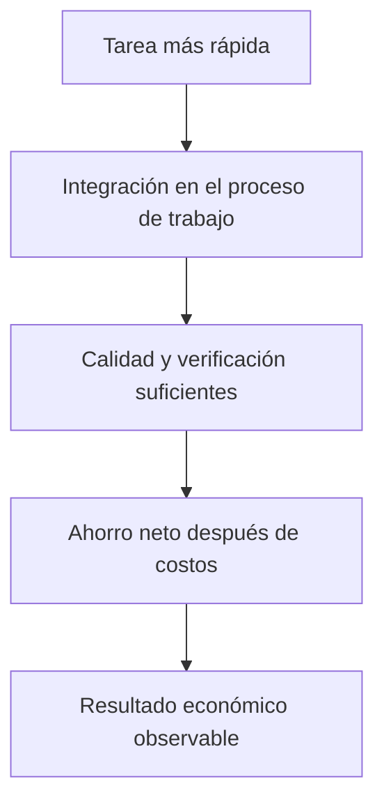

# IA en el contexto social II: beneficios, costos y decisiones

**Martes 17 de noviembre de 2026.** Apunte basado en las **50 diapositivas** de «Clase 25: IA en el contexto social II», de Carlos Hernández. El plan del curso anunciaba «Fundamentos filosóficos»; esta nota desarrolla la presentación proporcionada.

> [!summary] Pregunta central
> Si la IA abarata producir, programar y resolver tareas, ¿cómo distribuimos sus beneficios y costos sin perder capacidad de aprender, verificar y responder por nuestras decisiones?

**Alcance del apunte.** Las cifras, estudios, estados legislativos y pronósticos se presentan **como aparecen citados en el material de clase**, sin una actualización externa independiente. Un resultado experimental, una estimación y un escenario futuro tienen alcances distintos. Los cálculos, ejemplos y actividades señalados como complementos didácticos son elaboración para estudiar.

## Diapositivas de la clase

![[AI 25 IA en el contexto social II.pdf]]

[[AI 25 IA en el contexto social II.pdf|Abrir la presentación completa]]. Las referencias a diapositivas de esta nota siguen la numeración del PDF.

| Recorrido | Diapositivas | Sección |
|---|---:|---|
| Repaso: lo que aprende la IA | 3–4 | 1 |
| Energía, escala y agua | 5–11 | 2 |
| Regulación y marcos de referencia | 12–17 | 3 |
| Usos, oportunidades y verificación | 18–25 | 4 |
| Trabajo, productividad y aprendizaje | 26–35 | 5–7 |
| Escenarios, alternativas y juicio | 36–45 | 8–10 |
| Referencias y siguiente sesión | 46–50 | Cierre |

## 1. Lo que aprende la IA depende de lo que podemos observar

*Diapositivas 3–4; conexión con la clase anterior.* La caricatura del repaso muestra a alguien buscando bajo una lámpara porque allí tiene luz, aunque no perdió allí las llaves. La analogía es que **tener datos sobre algo no lo convierte automáticamente en la pregunta que necesitamos resolver**.

Podemos entrenar un modelo preciso sobre un indicador que representa mal el problema. Por ejemplo, predecir gasto médico no equivale necesariamente a medir necesidad de atención: el gasto observado también refleja acceso a servicios. Este ejemplo es un complemento didáctico para distinguir la variable disponible de la finalidad social.

La conexión con [[2026-11-12 IA - IA en el contexto social I|IA en el contexto social I]] es directa: muestreo, etiquetas, objetivo y despliegue condicionan los resultados. La discusión social comienza al elegir **qué medir y qué automatizar**.

## 2. Energía y agua: el costo aparece en la escala

*Diapositivas 5–11.*

### 2.1 Potencia y energía

La **potencia** indica la rapidez de consumo; la **energía** acumula ese consumo durante un tiempo. Si la potencia es constante:

$$
E\;[\mathrm{kWh}]=\frac{P\;[\mathrm W]}{1000}\,t\;[\mathrm h].
$$

Un LED de 10 W encendido 100 horas consume 1 kWh. La presentación compara un cuerpo humano con unos 100 W promedio y el cerebro con unos 20 W. Son referencias de escala: el cerebro y un clúster no realizan necesariamente la misma tarea, ni la potencia por sí sola mide inteligencia o eficiencia.

| Referencia de las slides | Orden de magnitud | Qué se está contando |
|---|---:|---|
| Alimentación de una persona | ~2.5 kWh/día | Energía química ingerida |
| Electricidad doméstica por persona en México | ~1.4 kWh/día | Promedio citado para el hogar |
| Gasolina para 23 km a 12 km/L | ~17 kWh | Energía del combustible, no trabajo útil en las ruedas |
| Laptop | 30–60 W | Potencia del equipo |
| GPU H100 de centro de datos | 700 W | Potencia de referencia de una GPU |
| 100,000 H100 | 70 MW | Solo las GPUs, según la comparación de la slide |

**Ejemplo calculado, no medición:** si las 100,000 GPUs consumieran continuamente 700 W cada una, en un día sumarían

$$
100{,}000(700\ \mathrm W)=70\ \mathrm{MW},\qquad
70\ \mathrm{MW}(24\ \mathrm h)=1{,}680\ \mathrm{MWh}.
$$

El resultado excluye otros equipos y refrigeración; tampoco supone que todas las GPUs reales operen siempre a esa potencia. Para comparar sistemas necesitamos especificar tarea, calidad de resultado, tiempo y límites del cálculo.

### 2.2 Una consulta pequeña puede sumar un consumo grande

La diapositiva 9 compara una consulta de texto con un LED encendido dos minutos y un video de cinco segundos con un microondas durante una hora. **Son comparaciones ilustrativas citadas por la presentación, no constantes universales por consulta.** Cambian con modelo, longitud, resolución, hardware, carga y número de intentos.

Un agente puede encadenar muchas consultas y herramientas para terminar una tarea. Por eso conviene comparar el consumo de **una tarea completada con calidad suficiente**, además del consumo de cada llamada.

Como complemento didáctico, si el consumo por uso se reduce a la mitad pero el número de usos se triplica, el consumo total aumenta a $0.5\times3=1.5$ veces el inicial. Este posible **efecto de rebote** explica por qué eficiencia y reducción del consumo total no son equivalentes.

### 2.3 El agua y la infraestructura tienen una ubicación

La diapositiva 10 cita oposición comunitaria a centros de datos en Estados Unidos y señala, para Querétaro, diez centros en operación y doce en construcción, en un contexto de sequía y racionamiento. Estas son cifras reportadas por el PDF; las preguntas relevantes son **qué agua se utiliza, dónde, con qué disponibilidad y quién puede revisar el consumo**.

El costo social incluye infraestructura eléctrica, abastecimiento y efectos sobre otras personas usuarias. Un mismo consumo de agua puede tener consecuencias diferentes según la cuenca, la época y el sistema de enfriamiento. La transparencia debería permitir distinguir mediciones, estimaciones y límites del reporte.

**Preguntas de clase:** ¿quién paga la ampliación de redes?, ¿dónde conviene instalar estos centros?, ¿qué usos justifican el costo?, ¿deberían reportarse por separado entrenamiento y uso?

## 3. Gobernar la IA: de principios a obligaciones

*Diapositivas 12–17.* La presentación organiza la regulación como una respuesta a daños concretos:

| Problema | Respuesta presentada | Qué se busca hacer revisable |
|---|---|---|
| Discriminación | Obligaciones y auditorías de sistemas de alto riesgo | Cómo se distribuyen las decisiones y los errores |
| Deepfakes y desinformación | Identificación de contenido generado | El origen y la autenticidad del contenido |
| Opacidad | Explicaciones de las decisiones | Por qué ocurrió un resultado y cómo objetarlo |
| Vigilancia y puntuación social | Prohibiciones de determinados usos | Límites a lo que se permite automatizar |
| Agentes y modelos potentes | Evaluaciones y reporte de incidentes | Riesgos y fallos del sistema completo |
| Energía y agua | Reporte del consumo | Costos y responsabilidades por los recursos |

### 3.1 Tres modelos y varios tipos de instrumento

La diapositiva 14, siguiendo a Bradford, contrasta tres orientaciones: **mercado e innovación** en Estados Unidos; **derechos y riesgo** en la Unión Europea; **control estatal y fomento industrial** en China. Son categorías de comparación de la clase; cada región contiene instrumentos y tensiones internas.

La comparación de OCDE, UNESCO, NIST, Ley de IA de la UE y principios del IIMAS enfatiza coincidencias en equidad, privacidad, transparencia, robustez, responsabilidad y supervisión. La diferencia central es **qué fuerza tiene cada instrumento y cómo se aplica**. Compartir un principio no implica tener las mismas obligaciones, procedimientos o sanciones. Las marcas de la tabla de la diapositiva 15 son una síntesis docente, no un inventario exhaustivo de cada documento.

### 3.2 La pirámide de riesgo de la UE en la presentación

La diapositiva 16 utiliza cuatro niveles para introducir la lógica del marco:

| Nivel del esquema | Respuesta resumida en la imagen |
|---|---|
| Inaceptable | Prohibición |
| Alto | Evaluación de conformidad |
| Limitado | Obligaciones de transparencia |
| Mínimo | La imagen indica ausencia de obligaciones específicas en ese esquema |

**Idea para estudiar:** la intensidad del control se relaciona con el riesgo del uso. La pirámide es una simplificación de clase; por sí sola no determina la clasificación jurídica de un proyecto ni su calendario de obligaciones. Para el desarrollo más amplio del tema, consultar la [[2026-11-12 IA - IA en el contexto social I#7. Leyes, normas y principios: distinguir su fuerza|nota anterior sobre leyes, normas y principios]].

### 3.3 México: una iniciativa no equivale a una ley

La diapositiva 17 presenta iniciativas de 2023 a 2026, desde propuestas de lineamientos éticos y agencias hasta niveles de riesgo, auditorías y una autoridad nacional. **La slide afirma que ninguna de las iniciativas de su tabla se había aprobado** y distingue «concluida», «en comisiones» y «sin dictamen». Aquí se registra lo expuesto en clase, sin verificar independientemente esos estados.

Para comprender el argumento basta conservar la distinción: **proponer una agencia o una obligación no demuestra que ya exista**. El nombre de una iniciativa tampoco permite inferir su contenido final. Si se necesita usar esta información fuera del repaso de la clase, corresponde consultar el texto y trámite oficiales de la propuesta concreta.

## 4. Producir se abarata; verificar conserva su costo

*Diapositivas 18–25.*

### 4.1 Usos y barreras de entrada

El gráfico de Chatterji et al. citado en la diapositiva 19 compara mensajes de ChatGPT por tema:

| Tema | Julio de 2024 | Junio de 2025 |
|---|---:|---:|
| Orientación práctica | 29 % | 29 % |
| Búsqueda de información | 14 % | 24 % |
| Escritura | 36 % | 24 % |
| Multimedia | 2 % | 7 % |
| Ayuda técnica | 12 % | 5 % |

Los renglones mostrados **no suman 100 %**: la slide selecciona categorías. Son proporciones de mensajes, no porcentajes de personas ni mediciones de la calidad de las respuestas.

La IA reduce barreras para programar, analizar datos y crear contenido. La presentación llama *vibe coding* a describir lo que se quiere y aceptar el código generado. **Poder obtener un programa no acredita por sí solo comprenderlo, mantenerlo o verificarlo.**

La diapositiva 21 cita un tutor de física estudiado por Kestin et al. y una tarea de programación con Copilot estudiada por Peng et al., en la que se reporta una ejecución aproximadamente 56 % más rápida. Son resultados de intervenciones y tareas particulares; no una mejora garantizada para cualquier estudiante, programa o entorno.

### 4.2 La asimetría entre generar y comprobar

Si generar contenido cuesta poco, puede crecer su volumen más rápido que nuestra capacidad de revisarlo. Autenticidad, exactitud y utilidad siguen exigiendo trabajo. La clase presenta el **dividendo del mentiroso**: la existencia de falsificaciones permite desacreditar evidencia auténtica alegando que también podría ser artificial.

Esto cambia el problema de confianza: además de detectar contenido falso, necesitamos conservar evidencia del origen, métodos de comprobación y responsabilidades. Un texto convincente no sustituye esa evidencia.

### 4.3 Autoría y formación profesional

La diapositiva 24 cita un artículo de *The AI Scientist* que pasó revisión por pares en un taller de ICLR 2025. La pregunta de la clase es qué certifica una tesis si se automatizan hipótesis, experimentos y redacción. Un caso aceptado en un taller no demuestra confiabilidad general de la investigación automatizada.

El producto final debe acompañarse de evidencia de comprensión: justificar la pregunta, explicar decisiones, reproducir resultados y responder objeciones. La diapositiva 25 propone cultivar **juicio, criterio, relaciones y responsabilidad**, además de las tareas que una herramienta puede ejecutar. El diagrama de conjuntos funciona como argumento formativo, no como una medición de todas las capacidades humanas y de IA.

## 5. Trabajo: exposición, sustitución y distribución

*Diapositivas 26–31.*

### 5.1 La paradoja de Moravec

Actividades que requieren gran esfuerzo consciente, como ciertos cálculos o juegos formales, pueden resultar relativamente accesibles para computadoras; actividades cotidianas de percepción y movimiento pueden ser muy difíciles de automatizar. La paradoja ayuda a explicar por qué la IA generativa incide en escritura, programación y trabajo de oficina antes de resolver de forma general las tareas manuales.

Es una comparación histórica de dificultades, no una regla según la cual toda tarea intelectual será fácil para una máquina. El contexto físico, la confiabilidad y el costo del despliegue también importan.

### 5.2 No confundir tres afirmaciones

| Concepto | Significado | Qué no demuestra por sí solo |
|---|---|---|
| Exposición | Algunas tareas de una ocupación pueden verse afectadas por IA | Que desaparecerá toda la ocupación |
| Sustitución | Una tarea antes humana pasa a ejecutarse con tecnología | Que el empleo total caerá en igual proporción |
| Complementariedad | La herramienta amplía o mejora el trabajo humano | Que las ganancias se repartirán equitativamente |

La presentación cita una de cada cuatro personas trabajadoras en ocupaciones expuestas a IA generativa en el mundo y, para México, 2.93 millones de personas en las ocupaciones de mayor exposición, equivalentes a 4.9 % del empleo. **Son categorías de exposición distintas**, no una comparación directa entre el mismo indicador global y mexicano.

La diapositiva 27 reúne un pronóstico de Amodei, despidos anunciados atribuidos a IA y una caída relativa de empleo juvenil en ocupaciones expuestas. Debemos distinguir **pronóstico, declaración empresarial y asociación observada**. Ninguno, aislado, identifica todo el efecto causal de la IA sobre el mercado laboral.

### 5.3 El problema del aprendizaje de quienes empiezan

La diapositiva 28 recoge la preocupación de Terence Tao por verificación, atribución y oportunidades de formación en matemáticas. Si la IA absorbe las tareas de entrada, surge una dificultad: esas tareas también eran el espacio donde una persona junior adquiría criterio y construía reconocimiento.

No basta exigir experiencia; hay que decidir **cómo se practica para llegar a tenerla**. Un uso formativo de IA debería conservar intentos propios, revisión de errores y una progresión hacia tareas más difíciles.

### 5.4 Productividad y poder de compra

La anécdota de Ford y Reuther de la diapositiva 30 plantea quién comprará los productos si se reduce el ingreso de quienes trabajan. La automatización modifica tanto producción como distribución. La expansión de la economía de creadores tampoco garantiza compradores o atención suficientes para todas las personas: la IA también puede competir por esa atención.

El tiempo liberado puede convertirse en más producción, reducción de jornada, aprendizaje, cuidado u ocio. **Que una herramienta ahorre tiempo no determina quién decide sobre ese ahorro.**

## 6. De una tarea más rápida a una economía más productiva

*Diapositivas 32–33.* La paradoja de productividad de Solow sirve para introducir una brecha: una tecnología puede impresionar en demostraciones sin producir inmediatamente una mejora agregada observable.

La diapositiva 33 cita efectos laborales pequeños de chatbots en Dinamarca, una estimación de Acemoglu de hasta 0.66 % de productividad total adicional en diez años y un informe de MIT NANDA según el cual alrededor de 95 % de los pilotos empresariales no mostraba impacto medible en ganancias. **Son estudios, estimaciones y muestras diferentes**; no deben combinarse como una tasa universal de fracaso de la IA.

Como complemento didáctico, una mejora local debe atravesar varios eslabones:

Por ejemplo, redactar un reporte en la mitad del tiempo puede ahorrar poco si revisar errores y reconstruir fuentes ocupa el tiempo restante. Para evaluar el beneficio hay que incluir integración, revisión, fallos y capacitación. **La productividad de una tarea, la ganancia de una empresa y la productividad de una economía son medidas distintas.**

## 7. Deuda cognitiva: terminar una tarea y aprender no son lo mismo

*Diapositivas 34–35.* La presentación llama **deuda cognitiva** a ganar rapidez hoy a costa de comprensión que faltará después. La analogía con la deuda técnica señala un costo diferido; no implica que todo apoyo de IA reduzca el aprendizaje.

La diapositiva 34 cita a Bastani et al.: estudiantes con ChatGPT sin guía mejoraron durante la práctica, pero rindieron peor en una evaluación sin IA. También cita a Kosmyna et al. sobre conectividad cerebral y sentido de autoría al escribir con LLM. Estos resultados deben conservar el alcance de sus tareas y condiciones: una diferencia en una medición cerebral no permite concluir por sí sola daño permanente o pérdida general de inteligencia.

### Ejemplo didáctico: dos formas de estudiar un algoritmo

| Uso orientado a terminar | Uso orientado a aprender |
|---|---|
| Pedir toda la solución y copiarla | Intentar primero y pedir una pista localizada |
| Aceptar una explicación porque suena clara | Explicarla con palabras propias y detectar un caso límite |
| Ejecutar código sin poder justificarlo | Predecir resultados y explicar cada decisión |
| Evaluarse siempre con la herramienta | Resolver después una variante sin ayuda |

**Comprobación concreta:** cerrar la herramienta y resolver una variante nueva. El desempeño con asistencia mide lo que logra el sistema persona–herramienta; el desempeño sin asistencia ayuda a observar qué se aprendió de manera autónoma.

La diapositiva 35 recuerda temores históricos sobre escritura, radio, cómics, televisión e internet. Reconocer un patrón de pánico tecnológico invita a pedir evidencia y mecanismos específicos. **La repetición histórica del temor no prueba que cualquier riesgo actual sea falso.**

## 8. Cuatro futuros posibles: capacidad y distribución son ejes distintos

*Diapositivas 36–39.* La presentación separa dos preguntas: **¿cuánto transforma la IA la economía?** y **¿quién recibe los beneficios?**

| | Beneficios compartidos | Beneficios concentrados |
|---|---|---|
| **IA transformadora** | Abundancia compartida | Concentración extrema |
| **IA gradual** | Complemento al trabajo humano | Burbuja y excusa, según el nombre del escenario de la clase |

Estos cuadrantes son **escenarios para razonar**, no predicciones con probabilidades calculadas. Una gran capacidad tecnológica no garantiza bienestar compartido. Una transformación limitada tampoco elimina la posibilidad de perjuicios para ciertos grupos.

### Explorar el mapa de escenarios

<iframe src="ia25-futuros-posibles.htm" style="width:100%;height:600px;border:1px solid var(--lightgray);border-radius:4px;" loading="lazy"></iframe>

**Idea central sin el recurso:** moverse de izquierda a derecha cambia la distribución de beneficios; moverse de abajo hacia arriba cambia la magnitud de la transformación. Selecciona un cuadrante y compara qué evidencia lo apoyaría y qué decisiones podrían modificarlo. Las señales y preguntas del recurso son un complemento didáctico; no son un modelo predictivo.

**Ejercicio:** compara «complemento» con «concentración extrema». Identifica qué cambió en cada eje y qué decisión sobre formación, propiedad o reparto de ganancias podría afectar la distribución.

### Daños presentes y riesgos futuros

La clase distingue víctimas de daños ya documentados, como fraudes, discriminación y deepfakes íntimos, de riesgos futuros inciertos de gran escala. Su propuesta es reconocer ambas agendas. Evaluaciones independientes y transparencia pueden ayudar a discutirlas, aunque las evidencias, escalas temporales y medidas pertinentes sean diferentes.

## 9. Las alternativas requieren decisiones colectivas

*Diapositiva 40.*

| Nivel | Alternativa de la presentación | Pregunta que permite discutir |
|---|---|---|
| Gobierno | Regular usos de riesgo | ¿Qué controles y límites corresponden a cada uso? |
| Gobierno y trabajo | Repartir el tiempo liberado | ¿Quién obtiene el ahorro de tiempo? |
| Trabajo organizado | Negociar la incorporación de IA | ¿Quién decide cómo cambia el puesto? |
| Política social | Experimentar con ingreso básico | ¿Cómo se sostienen ingresos y autonomía? |
| Universidades | Evaluar proceso y producto | ¿Cómo se demuestra comprensión y autoría? |
| Personas | Elegir qué delegar y qué practicar | ¿Qué capacidades queremos conservar? |

La slide menciona negociación de guionistas de Hollywood, experiencias de ingreso básico y reducción de jornada en México. Se registran como ejemplos del argumento de clase; una negociación, un experimento y una medida legal requieren criterios distintos para evaluar resultados. No hay una única alternativa que resuelva todos los problemas.

## 10. Las cuatro D: una práctica para colaborar con IA

*Diapositivas 41–45.*

| D | Pregunta de la clase | Aplicación didáctica a un trabajo académico |
|---|---|---|
| **Delegación** | ¿Debería esta tarea pasar por la IA? | Elegir qué automatizar y qué conservar como práctica propia |
| **Descripción** | ¿Le di suficiente contexto para acertar? | Proporcionar objetivo, datos, restricciones y criterios de aceptación |
| **Discernimiento** | ¿El resultado realmente sirve? | Comprobar fuentes, cálculos, supuestos y casos límite |
| **Diligencia** | ¿Respondo por lo que entrego? | Revisar la versión final, documentar el uso y poder defender el resultado |

**Ejemplo complementario.** En un proyecto de clasificación se puede delegar un primer borrador de código. La descripción debe incluir formato de datos y métricas; el discernimiento revisa fugas de información y errores por grupo; la diligencia exige reproducir el resultado y poder explicarlo. La delegación no transfiere automáticamente la responsabilidad a la herramienta.

El cierre de la clase insiste en que los usos de IA dependen de decisiones de personas, empresas e instituciones. La cita de Sagan conecta dependencia tecnológica con necesidad de comprensión pública. La invitación a formar una opinión propia no exige elegir entre entusiasmo y rechazo: exige **razones, evidencia y una postura sobre quién asume los costos**.

## Preguntas de repaso

1. **¿Qué diferencia W de kWh?** Potencia frente a energía acumulada; hace falta tiempo para pasar de una a otra.
2. **¿Por qué una consulta eficiente puede acompañar un consumo total mayor?** Porque pueden aumentar los usos, los pasos del agente y la cantidad de contenido.
3. **¿Qué diferencia una iniciativa de una obligación vigente?** La propuesta debe completar el procedimiento aplicable; su sola presentación no la convierte en ley.
4. **¿Por qué producir más texto no resuelve el problema de confianza?** Aumenta el material que necesita verificación y no acredita su origen o exactitud.
5. **¿Exposición equivale a desempleo?** No; identifica tareas susceptibles de cambio, cuyo efecto depende de sustitución, complementariedad y organización.
6. **¿Una tarea 56 % más rápida implica 56 % más de productividad nacional?** No; difieren la unidad de análisis, los costos y el alcance de la medición.
7. **¿Cómo distinguir asistencia de aprendizaje?** Comprobando si después se puede explicar y resolver una variante sin ayuda.
8. **¿Por qué el mapa de futuros necesita dos ejes?** Porque capacidad tecnológica y distribución de beneficios pueden variar por separado.
9. **¿Qué D corresponde a verificar una referencia inventada?** Discernimiento; diligencia exige hacerse cargo de corregirla antes de entregar.

## Dudas para discutir

- [ ] ¿Qué evidencia nos permitiría elegir un cuadrante sin depender solo de demostraciones o declaraciones empresariales?
- [ ] ¿Cómo medimos energía y agua por tarea útil con límites de sistema comparables?
- [ ] ¿Cómo diseñar tareas de entrada que formen criterio cuando ya existe asistencia de IA?
- [ ] ¿Qué partes de nuestro proyecto podemos defender sin consultar al modelo?
- [ ] ¿Qué mecanismos concretos repartirían el tiempo y los beneficios de productividad?

## Referencias mencionadas en las diapositivas

Selección para localizar los argumentos; los datos bibliográficos se toman de las diapositivas 46–49. No se presentan como lecturas verificadas de forma independiente.

| Tema | Referencias de la presentación |
|---|---|
| Marcos y regulación | Bradford, *Digital Empires* (2023); OCDE, recomendación de IA (2019, revisada en 2024); UNESCO, recomendación ética (2021); NIST, AI RMF (2023) y perfil de IA generativa (2024) |
| Usos de ChatGPT | Chatterji et al., *How People Use ChatGPT*, NBER Working Paper 34255 (2025) |
| Trabajo | Moravec, *Mind Children* (1988); Eloundou et al., *GPTs are GPTs* (2024); Brynjolfsson, Chandar y Chen, *Canaries in the Coal Mine?* (2025); OIT y NASK, Working Paper 140 (2025) |
| Productividad | Humlum y Vestergaard, NBER Working Paper 33777 (2025); Acemoglu, *The simple macroeconomics of AI* (2025); MIT NANDA, *The GenAI Divide* (2025) |
| Aprendizaje y programación | Kestin et al., *AI tutoring outperforms in-class active learning* (2025); Peng et al., arXiv:2302.06590 (2023); Bastani et al., *Generative AI without guardrails can harm learning* (2025); Kosmyna et al., arXiv:2506.08872 (2025) |
| Confianza y debate | Chesney y Citron, *Deep Fakes* (2019); Narayanan y Kapoor, *AI Snake Oil* (2024); Orben, *The Sisyphean Cycle of Technology Panics* (2020) |
| Alternativas | WGA, resumen del acuerdo MBA (2023); Kela, experimento de ingreso básico 2017–2018 (2020); Vivalt et al., NBER Working Paper 32719 (2024) |

## Conexiones y siguiente sesión

- [[2026-11-12 IA - IA en el contexto social I|Clase anterior: agentes, justicia y regulación]].
- [[2026-11-10 IA - Aprendizaje profundo|Modelos de lenguaje: capacidades y funcionamiento]].
- [[2026-10-27 IA - Aprendizaje supervisado y clasificacion|Clasificación: métricas, objetivos y evaluación]].
- [[Indice|Índice de Inteligencia Artificial]].
- La diapositiva 50 anuncia **cierre del curso** para la siguiente sesión; no contiene un nuevo entregable.

## Resumen después de clase

La IA reduce barreras para producir y resolver tareas, pero la verificación, la formación y la responsabilidad siguen requiriendo trabajo. Su costo material depende de escala, infraestructura y ubicación; su impacto laboral depende tanto de las tareas como del reparto de beneficios. Ahorrar tiempo con una herramienta no garantiza productividad agregada ni aprendizaje autónomo. Los escenarios futuros y las cuatro D ayudan a hacer explícitas decisiones sobre qué delegar, cómo comprobarlo y quién responde por sus consecuencias.
