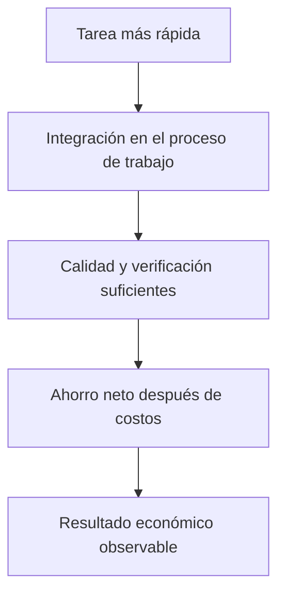

# IA en el contexto social II: beneficios, costos y decisiones

**Martes 17 de noviembre de 2026.** Apunte **autocontenido** de la clase «IA en el contexto social II» (Carlos Hernández). El plan del curso anunciaba «Fundamentos filosóficos»; esta nota desarrolla el contenido efectivamente visto. Cada cifra, tabla y esquema mencionado en clase se reproduce aquí con su fuente.

> [!summary] Pregunta central
> Si la IA abarata producir, programar y resolver tareas, ¿cómo distribuimos sus beneficios y costos sin perder capacidad de aprender, verificar y responder por nuestras decisiones?

**Alcance del apunte.** Las cifras, estudios, estados legislativos y pronósticos se presentan **como se citaron en clase**, sin una actualización externa independiente. Un resultado experimental, una estimación y un escenario futuro tienen alcances distintos. Los cálculos, ejemplos y actividades señalados como complementos didácticos son elaboración para estudiar.

## Recorrido

| Tema | Sección |
|---|---|
| Repaso: lo que aprende la IA | 1 |
| Energía, escala y agua | 2 |
| Regulación y marcos de referencia | 3 |
| Usos, oportunidades y verificación | 4 |
| Trabajo, productividad y aprendizaje | 5–7 |
| Escenarios, alternativas y juicio | 8–10 |
| Referencias y siguiente sesión | Cierre |

## 1. Lo que aprende la IA depende de lo que podemos observar

*Conexión con la clase anterior.* El repaso se resumió con una caricatura: de noche, una persona con una laptop marcada «AI» busca a gatas bajo una farola; otra le pregunta «¿Perdiste las llaves aquí?» y responde «No, pero aquí es donde tenemos datos». Las llaves están a lo lejos, en la penumbra. La analogía es que **tener datos sobre algo no lo convierte automáticamente en la pregunta que necesitamos resolver**.

Podemos entrenar un modelo preciso sobre un indicador que representa mal el problema. Por ejemplo, predecir gasto médico no equivale necesariamente a medir necesidad de atención: el gasto observado también refleja acceso a servicios. Este ejemplo es un complemento didáctico para distinguir la variable disponible de la finalidad social.

La conexión con [[2026-11-12 IA - IA en el contexto social I|IA en el contexto social I]] es directa: muestreo, etiquetas, objetivo y despliegue condicionan los resultados. La discusión social comienza al elegir **qué medir y qué automatizar**.

## 2. Energía y agua: el costo aparece en la escala


### 2.1 Potencia y energía

**Energía y el cuerpo humano.** Una persona come 2,000–2,500 kcal al día, ~2.5 kWh; su potencia promedio es ~100 W, como un foco incandescente. El cerebro usa ~20 W, una quinta parte de la energía en reposo, y con ellos percibe, recuerda, aprende y decide.

La **potencia** indica la rapidez de consumo; la **energía** acumula ese consumo durante un tiempo. Si la potencia es constante:

$$
E\;[\mathrm{kWh}]=\frac{P\;[\mathrm W]}{1000}\,t\;[\mathrm h].
$$

Un LED de 10 W encendido 100 horas consume 1 kWh. Se suele comparar un cuerpo humano (unos 100 W promedio) con el cerebro (unos 20 W). Son referencias de escala: el cerebro y un clúster no realizan necesariamente la misma tarea, ni la potencia por sí sola mide inteligencia o eficiencia.

| Referencia | Orden de magnitud | Qué se está contando |
|---|---:|---|
| Toda la energía del país, por habitante (México) | ~60 kWh/día | Consumo energético total dividido entre habitantes |
| Alimentación de una persona | ~2.5 kWh/día | Energía química ingerida |
| Electricidad doméstica por persona en México | ~1.4 kWh/día | Promedio citado para el hogar |
| Gasolina para 23 km a 12 km/L | ~17 kWh/día | Energía del combustible, no trabajo útil en las ruedas |
| Refrigerador eficiente | ~1 kWh/día por hogar | Consumo de un aparato |
| Foco LED de 10 W encendido todo el día | 0.24 kWh/día | Potencia por 24 h |
| Cerebro humano | ~20 W | Reposo |
| Laptop | 30–60 W | Potencia del equipo |
| PC de juegos | 200–500 W | Potencia del equipo |
| GPU de juegos (RTX 5090) | 575 W | Potencia de una GPU |
| GPU H100 de centro de datos | 700 W | Potencia de referencia de una GPU |
| GPU B200 de centro de datos | 1,000 W | Potencia de referencia de una GPU |
| Rack de 72 GPUs (GB200 NVL72) | ~120,000 W | Un rack completo |
| 100,000 H100 | 70 MW | Solo las GPUs, según la comparación de clase |

Fuentes citadas: SENER (Balance Nacional de Energía), SEMARNAT, INEGI, etiquetas de eficiencia energética, SinTráfico, Epoch AI (2025), fichas técnicas de NVIDIA y Raichle y Gusnard (2002).

**Ejemplo calculado, no medición:** si las 100,000 GPUs consumieran continuamente 700 W cada una, en un día sumarían

$$
100{,}000(700\ \mathrm W)=70\ \mathrm{MW},\qquad
70\ \mathrm{MW}(24\ \mathrm h)=1{,}680\ \mathrm{MWh}.
$$

El resultado excluye otros equipos y refrigeración; tampoco supone que todas las GPUs reales operen siempre a esa potencia. Para comparar sistemas necesitamos especificar tarea, calidad de resultado, tiempo y límites del cálculo.

### 2.2 Una consulta pequeña puede sumar un consumo grande

Una consulta de texto equivale, en energía, a un LED encendido dos minutos, y un video de cinco segundos a un microondas durante una hora. **Son comparaciones ilustrativas, no constantes universales por consulta.** Cambian con modelo, longitud, resolución, hardware, carga y número de intentos.

Un agente puede encadenar muchas consultas y herramientas para terminar una tarea. Por eso conviene comparar el consumo de **una tarea completada con calidad suficiente**, además del consumo de cada llamada.

Como complemento didáctico, si el consumo por uso se reduce a la mitad pero el número de usos se triplica, el consumo total aumenta a $0.5\times3=1.5$ veces el inicial. Este posible **efecto de rebote** explica por qué eficiencia y reducción del consumo total no son equivalentes.

### 2.3 El agua y la infraestructura tienen una ubicación

Se citó que en EUA 843 grupos locales se oponen a centros de datos en 49 estados; que en el primer trimestre de 2026 bloquearon o retrasaron ~75 proyectos por ~130,000 millones de dólares; y que ~70 % de los estadounidenses rechaza un centro de datos de IA cerca de su casa (Data Center Watch, 2026; Gallup). Para Querétaro: diez centros en operación y doce en construcción, en un estado con sequía y racionamiento, y las empresas no reportan cuánta agua usan (Thomson Reuters Foundation, 2025; Pulitzer Center, 2026). Son cifras reportadas en clase; las preguntas relevantes son **qué agua se utiliza, dónde, con qué disponibilidad y quién puede revisar el consumo**.

El costo social incluye infraestructura eléctrica, abastecimiento y efectos sobre otras personas usuarias. Un mismo consumo de agua puede tener consecuencias diferentes según la cuenca, la época y el sistema de enfriamiento. La transparencia debería permitir distinguir mediciones, estimaciones y límites del reporte.

**Preguntas de clase:** ¿deben las empresas reportar energía y agua por consulta y por entrenamiento?, ¿quién paga la red eléctrica y el agua que necesitan los centros de datos?, ¿dónde construirlos en un país con estrés hídrico?, ¿la eficiencia reduce el consumo total o lo aumenta al abaratar el uso?, ¿qué usos de la IA justifican su costo energético?, ¿cómo comparar 20 W de un cerebro con 70 MW de un clúster?

## 3. Gobernar la IA: de principios a obligaciones

La regulación se organiza como una respuesta a daños concretos:

| Problema | Respuesta presentada | Qué se busca hacer revisable |
|---|---|---|
| Discriminación | Obligaciones y auditorías de sistemas de alto riesgo | Cómo se distribuyen las decisiones y los errores |
| Deepfakes y desinformación | Identificación de contenido generado | El origen y la autenticidad del contenido |
| Opacidad | Explicaciones de las decisiones | Por qué ocurrió un resultado y cómo objetarlo |
| Vigilancia y puntuación social | Prohibiciones de determinados usos | Límites a lo que se permite automatizar |
| Agentes y modelos potentes | Evaluaciones y reporte de incidentes | Riesgos y fallos del sistema completo |
| Energía y agua | Reporte del consumo | Costos y responsabilidades por los recursos |

### 3.1 Tres modelos y varios tipos de instrumento

| Región | Enfoque | Instrumentos |
|---|---|---|
| EUA | Mercado e innovación | Órdenes ejecutivas, leyes estatales y control de exportación de chips |
| Unión Europea | Derechos y riesgo | Ley de IA (2024) y RGPD (2018) |
| China | Control del Estado y fomento industrial | Reglas por tecnología, registro previo y etiquetado |

Siguiendo a Bradford, se contrastan tres orientaciones: **mercado e innovación** en Estados Unidos; **derechos y riesgo** en la Unión Europea; **control estatal y fomento industrial** en China. Son categorías de comparación de la clase; cada región contiene instrumentos y tensiones internas.

La comparación de OCDE, UNESCO, NIST, Ley de IA de la UE y principios del IIMAS (principios institucionales) se resume así:

| Tema | OCDE | UNESCO | NIST | Ley de IA UE | IIMAS |
|---|:-:|:-:|:-:|:-:|:-:|
| Equidad y no discriminación | ✓ | ✓ | ✓ | ✓ | ✓ |
| Privacidad | ✓ | ✓ | ✓ | ✓ | ✓ |
| Transparencia y explicabilidad | ✓ | ✓ | ✓ | ✓ | ✓ |
| Seguridad y robustez | ✓ | ✓ | ✓ | ✓ | ✓ |
| Rendición de cuentas | ✓ | ✓ | ✓ | ✓ | ✓ |
| Supervisión humana | ✓ | ✓ | ✓ | ✓ | ✓ |
| Medio ambiente | ✓ | ✓ | ✓ | ✓ | ✓ |
| Bienestar social | ✓ | ✓ | ✗ | ✗ | ✓ |
| Formación de personas en IA | ✓ | ✓ | ✗ | ✓ | ✗ |
| Prohibiciones | ✗ | ✓ | ✗ | ✓ | ✗ |
| Obligatorio | ✗ | ✗ | ✗ | ✓ | ✗ |

Los marcos coinciden en los principios y difieren en si obligan. Esa tabla enfatiza coincidencias en equidad, privacidad, transparencia, robustez, responsabilidad y supervisión. La diferencia central es **qué fuerza tiene cada instrumento y cómo se aplica**. Compartir un principio no implica tener las mismas obligaciones, procedimientos o sanciones. Las coincidencias entre estos instrumentos son una síntesis docente, no un inventario exhaustivo de cada documento.

### 3.2 La pirámide de riesgo de la UE

La lógica del marco europeo se introduce con una pirámide de cuatro niveles (de arriba hacia abajo: inaceptable, alto, limitado, mínimo):

```text
          /\
         /  \        Inaceptable → prohibición
        /----\
       /      \      Alto → evaluación de conformidad
      /--------\
     /          \    Limitado → obligaciones de transparencia
    /------------\
   /              \  Mínimo → sin obligaciones específicas
  /________________\
```

En forma de tabla:

| Nivel del esquema | Usos que el esquema asocia | Respuesta resumida |
|---|---|---|
| Inaceptable | Puntuación social, vigilancia masiva, manipulación del comportamiento que causa daño | Prohibición |
| Alto | Acceso a empleo, educación y servicios públicos; componentes de seguridad de vehículos; aplicación de la ley, entre otros | Evaluación de conformidad |
| Limitado | Suplantación, chatbots, reconocimiento de emociones, categorización biométrica, deepfakes | Obligaciones de transparencia |
| Mínimo | El resto | El esquema indica ausencia de obligaciones específicas |

**Idea para estudiar:** la intensidad del control se relaciona con el riesgo del uso. La pirámide es una simplificación de clase; por sí sola no determina la clasificación jurídica de un proyecto ni su calendario de obligaciones. Para el desarrollo más amplio del tema, consultar la [[2026-11-12 IA - IA en el contexto social I#7. Leyes, normas y principios: distinguir su fuerza|nota anterior sobre leyes, normas y principios]].

### 3.3 México: una iniciativa no equivale a una ley

Se revisaron las siguientes iniciativas. **Se afirmó que ninguna se había aprobado**; en octubre de 2026 el Senado propuso empezar por un plan nacional de IA. Aquí se registra lo expuesto en clase, sin verificar independientemente esos estados.

| Fecha | Iniciativa | Qué propone | Estado |
|---|---|---|---|
| Abr 2023 | Ley para la regulación ética de la IA y la robótica | Lineamientos éticos y un Consejo Mexicano de Ética para la IA | Concluida |
| Sep 2023 | Reforma al art. 73 constitucional | Facultar al Congreso para legislar en IA, ciberseguridad y neuroderechos | Concluida |
| Oct 2023 | Ley de la Agencia Mexicana para el Desarrollo de la IA | Una agencia de políticas de IA en educación, empleo e infraestructura | Concluida |
| Nov 2023 | Ley que Regula el uso de la IA | Prohibir la manipulación subliminal, la discriminación y los deepfakes | Concluida |
| Abr 2024 | Ley Federal que regula la IA | Niveles de riesgo como en la UE, con supervisión del IFT | Concluida y presentada de nuevo en 2026 |
| Oct 2024 | Ley Nacional que regula el uso de la IA | Niveles de riesgo, Centro Nacional de IA y multas | En comisiones |
| 2025 | Ley Federal para el Desarrollo Ético, Soberano e Inclusivo de la IA | Desarrollo ético de la IA y soberanía tecnológica | En comisiones |
| Abr 2026 | Ley General para Regular y Fomentar el uso de la IA | Usos prohibidos, de alto riesgo y limitados, auditorías y una Autoridad Nacional de IA | Sin dictamen |

Se distinguieron los estados «concluida», «en comisiones» y «sin dictamen».

Para comprender el argumento basta conservar la distinción: **proponer una agencia o una obligación no demuestra que ya exista**. El nombre de una iniciativa tampoco permite inferir su contenido final. Si se necesita usar esta información fuera del repaso de la clase, corresponde consultar el texto y trámite oficiales de la propuesta concreta.

## 4. Producir se abarata; verificar conserva su costo


### 4.1 Usos y barreras de entrada

El gráfico de Chatterji et al. compara mensajes de ChatGPT por tema:

| Tema | Julio de 2024 | Junio de 2025 |
|---|---:|---:|
| Orientación práctica | 29 % | 29 % |
| Búsqueda de información | 14 % | 24 % |
| Escritura | 36 % | 24 % |
| Multimedia | 2 % | 7 % |
| Ayuda técnica | 12 % | 5 % |

Los renglones mostrados **no suman 100 %**: el gráfico selecciona categorías. Son proporciones de mensajes, no porcentajes de personas ni mediciones de la calidad de las respuestas.

La IA reduce barreras para programar, analizar datos y crear contenido. En 2023 Andrej Karpathy escribió que el nuevo lenguaje de programación más popular es el inglés, y en 2025 acuñó «*vibe coding*». Se llama *vibe coding* a describir lo que se quiere y aceptar el código generado. **Poder obtener un programa no acredita por sí solo comprenderlo, mantenerlo o verificarlo.**

Se citan un tutor de IA con el que estudiantes de física de Harvard aprendieron más en menos tiempo (Kestin et al., 2025) y una tarea de programación con GitHub Copilot que programadores terminaron 56 % más rápido (Peng et al., 2023). También se mencionó que un agente de programación escribe, prueba y corrige programas completos a partir de una descripción. Son resultados de intervenciones y tareas particulares; no una mejora garantizada para cualquier estudiante, programa o entorno.

### 4.2 La asimetría entre generar y comprobar

Generar la imagen del papa con abrigo blanco tomó segundos y desmentirla tomó días. Si generar contenido cuesta poco, puede crecer su volumen más rápido que nuestra capacidad de revisarlo. Autenticidad, exactitud y utilidad siguen exigiendo trabajo. La clase presenta el **dividendo del mentiroso**: la existencia de falsificaciones permite desacreditar evidencia auténtica alegando que también podría ser artificial.

Esto cambia el problema de confianza: además de detectar contenido falso, necesitamos conservar evidencia del origen, métodos de comprobación y responsabilidades. Un texto convincente no sustituye esa evidencia.

### 4.3 Autoría y formación profesional

La IA ya propone hipótesis, programa experimentos y redacta artículos. Se cita un artículo de *The AI Scientist* que pasó revisión por pares en un taller de ICLR 2025. La pregunta de la clase es qué certifica una tesis si se automatizan hipótesis, experimentos y redacción. Un caso aceptado en un taller no demuestra confiabilidad general de la investigación automatizada.

El producto final debe acompañarse de evidencia de comprensión: justificar la pregunta, explicar decisiones, reproducir resultados y responder objeciones. Se propone cultivar **juicio, criterio, relaciones y responsabilidad**, además de las tareas que una herramienta puede ejecutar. El diagrama de conjuntos contrasta dos círculos: «lo que hace la IA» (grande) y «lo que hacemos» (pequeño). Si el segundo cae por completo dentro del primero (subconjunto), somos reemplazables; si una parte queda fuera (intersección), lo propio queda fuera de la IA, y formarse es cultivar esa parte: juicio, criterio, relaciones y responsabilidad. El diagrama funciona como argumento formativo, no como una medición de todas las capacidades humanas y de IA.

## 5. Trabajo: exposición, sustitución y distribución


### 5.1 La paradoja de Moravec

Actividades que requieren gran esfuerzo consciente, como ciertos cálculos o juegos formales, pueden resultar relativamente accesibles para computadoras; actividades cotidianas de percepción y movimiento pueden ser muy difíciles de automatizar. La paradoja ayuda a explicar por qué la IA generativa incide en escritura, programación y trabajo de oficina antes de resolver de forma general las tareas manuales.

Moravec (1988) lo formuló así: lo difícil para nosotros es fácil para una computadora y lo fácil es difícil. Durante décadas se creyó que la automatización eliminaría primero el trabajo manual y de baja calificación; la IA generativa llegó antes al trabajo de oficina, creativo y profesional, y los empleos de mayor salario resultaron los más expuestos. Deep Blue derrotó a Kasparov en 1997 y casi 30 años después los robots siguen teniendo problemas para doblar ropa. El riesgo alcanza a ambos extremos, y quizá más a los profesionistas.

Es una comparación histórica de dificultades, no una regla según la cual toda tarea intelectual será fácil para una máquina. El contexto físico, la confiabilidad y el costo del despliegue también importan.

### 5.2 No confundir tres afirmaciones

| Concepto | Significado | Qué no demuestra por sí solo |
|---|---|---|
| Exposición | Algunas tareas de una ocupación pueden verse afectadas por IA | Que desaparecerá toda la ocupación |
| Sustitución | Una tarea antes humana pasa a ejecutarse con tecnología | Que el empleo total caerá en igual proporción |
| Complementariedad | La herramienta amplía o mejora el trabajo humano | Que las ganancias se repartirán equitativamente |

Se cita una de cada cuatro personas trabajadoras en ocupaciones expuestas a IA generativa en el mundo; en países de ingreso alto, la exposición más alta alcanza 9.6 % del empleo femenino y 3.5 % del masculino. Para México, 2.93 millones de personas en las ocupaciones de mayor exposición, equivalentes a 4.9 % del empleo, de las cuales el apoyo administrativo concentra 1.21 millones y la contabilidad 470,000 (OIT y NASK, 2025; México, ¿cómo vamos? con la ENOE 2026). **Son categorías de exposición distintas**, no una comparación directa entre el mismo indicador global y mexicano.

Se reúnen un pronóstico de Amodei (mayo de 2025: la IA podría eliminar la mitad de los empleos de entrada de oficina y llevar el desempleo en EUA a 10–20 % en uno a cinco años), ~121,000 despidos anunciados hasta octubre de 2026 que empresas de EUA atribuyeron a la IA (Oracle, Coinbase y Wix citaron a la IA en sus recortes), una pérdida de 13 % de empleo relativo de jóvenes de 22 a 25 años en ocupaciones expuestas (Stanford, 2025) y que 22 % de los directores de recursos humanos reporta que se dejó de contratar puestos de entrada por la IA. Debemos distinguir **pronóstico, declaración empresarial y asociación observada**. Ninguno, aislado, identifica todo el efecto causal de la IA sobre el mercado laboral.

### 5.3 El problema del aprendizaje de quienes empiezan

Se recoge la preocupación de Terence Tao (medalla Fields 2006), de los primeros matemáticos en usar IA para explorar y verificar demostraciones. En 2023 predijo que hacia 2026 la IA sería una coautora confiable en investigación matemática; en septiembre de 2026 publicó «A severe misalignment of AI in mathematics», donde critica que las empresas usen problemas matemáticos como benchmarks, teme que la IA quite a los jóvenes los problemas con los que se forman y se dan a conocer, señala resultados mal descritos y uso de trabajo previo sin atribución, y pide una «matemática 2.0» con nuevas reglas de verificación y crédito. Si la IA absorbe las tareas de entrada, surge una dificultad: esas tareas también eran el espacio donde una persona junior adquiría criterio y construía reconocimiento.

No basta exigir experiencia; hay que decidir **cómo se practica para llegar a tenerla**. Un uso formativo de IA debería conservar intentos propios, revisión de errores y una progresión hacia tareas más difíciles.

### 5.4 Productividad y poder de compra

Una anécdota atribuida a un ejecutivo de Ford y al líder sindical Walter Reuther, ante una fábrica automatizada, dice: «—¿Cómo va a lograr que estos robots paguen cuotas sindicales? —¿Cómo va a lograr que compren autos Ford?». Plantea quién comprará los productos si se reduce el ingreso de quienes trabajan: las empresas venden servicios y entretenimiento a personas con salario. La automatización modifica tanto producción como distribución. La expansión de la economía de creadores tampoco garantiza compradores o atención suficientes para todas las personas: en 2019, 29 % de los niños en EUA quería ser youtuber y 11 % astronauta; Goldman Sachs estima la economía de creadores en ~250,000 millones de dólares y ~480,000 millones hacia 2027; y The Velvet Sundown, una banda generada con IA, superó un millón de reproducciones mensuales en Spotify (2025). La IA también puede competir por esa atención; Juvenal criticó que el pueblo romano cambiara su voz política por pan y circo.

La clase recordó que la lavadora, el refrigerador y la estufa liberaron horas de trabajo doméstico; que Keynes predijo en 1930 que sus nietos trabajarían 15 horas a la semana, mientras hoy la semana laboral en países desarrollados es de 35 a 40 horas; y que México reducirá la jornada máxima de 48 a 40 horas entre 2027 y 2030. La IA promete lo mismo: menos tiempo en tareas rutinarias, con la pregunta de para qué usaremos ese tiempo libre.

El tiempo liberado puede convertirse en más producción, reducción de jornada, aprendizaje, cuidado u ocio. **Que una herramienta ahorre tiempo no determina quién decide sobre ese ahorro.**

## 6. De una tarea más rápida a una economía más productiva

Solow (1987) dijo que se ve la era de la computadora en todas partes, menos en las estadísticas de productividad. Esa paradoja sirve para introducir una brecha: una tecnología puede impresionar en demostraciones sin producir inmediatamente una mejora agregada observable.

Se citan efectos laborales pequeños de chatbots en Dinamarca (no cambiaron los ingresos ni las horas de trabajo y ahorraron ~3 % del tiempo), una estimación de Acemoglu de hasta 0.66 % de productividad total adicional en diez años y un informe de MIT NANDA según el cual alrededor de 95 % de los pilotos empresariales no mostraba impacto medible en ganancias. Además, las empresas que más recortaron no mejoraron sus resultados financieros. **Son estudios, estimaciones y muestras diferentes**; no deben combinarse como una tasa universal de fracaso de la IA: la IA impresiona en la demostración y todavía no en la economía.

Como complemento didáctico, una mejora local debe atravesar varios eslabones:



Por ejemplo, redactar un reporte en la mitad del tiempo puede ahorrar poco si revisar errores y reconstruir fuentes ocupa el tiempo restante. Para evaluar el beneficio hay que incluir integración, revisión, fallos y capacitación. **La productividad de una tarea, la ganancia de una empresa y la productividad de una economía son medidas distintas.**

## 7. Deuda cognitiva: terminar una tarea y aprender no son lo mismo

Se llama **deuda cognitiva** a ganar rapidez hoy a costa de comprensión que faltará después. La analogía con la deuda técnica señala un costo diferido; no implica que todo apoyo de IA reduzca el aprendizaje.

Se cita a Bastani et al.: estudiantes con ChatGPT sin guía mejoraron durante la práctica, pero rindieron peor en una evaluación sin IA. También se cita a Kosmyna et al. sobre conectividad cerebral y sentido de autoría al escribir con LLM. Estos resultados deben conservar el alcance de sus tareas y condiciones: una diferencia en una medición cerebral no permite concluir por sí sola daño permanente o pérdida general de inteligencia.

### Ejemplo didáctico: dos formas de estudiar un algoritmo

| Uso orientado a terminar | Uso orientado a aprender |
|---|---|
| Pedir toda la solución y copiarla | Intentar primero y pedir una pista localizada |
| Aceptar una explicación porque suena clara | Explicarla con palabras propias y detectar un caso límite |
| Ejecutar código sin poder justificarlo | Predecir resultados y explicar cada decisión |
| Evaluarse siempre con la herramienta | Resolver después una variante sin ayuda |

**Comprobación concreta:** cerrar la herramienta y resolver una variante nueva. El desempeño con asistencia mide lo que logra el sistema persona–herramienta; el desempeño sin asistencia ayuda a observar qué se aprendió de manera autónoma.

Se recuerdan temores históricos, resumidos en la tabla siguiente (Orben, 2020, llama a este patrón el «ciclo de Sísifo» de los pánicos tecnológicos; la pregunta es si la IA es un caso más):

| Año | Tecnología | El temor |
|---|---|---|
| ~370 a.C. | Escritura | Platón (*Fedro*): producirá olvido y una sabiduría solo aparente |
| 1545 | Libros impresos | Gessner: una abundancia de libros confusa y dañina |
| Años 30 | Radio | Asusta a los niños y los distrae de la tarea |
| 1954 | Cómics | Wertham: causan delincuencia juvenil; el Senado de EUA abre audiencias |
| 1961 | Televisión | Minow, regulador de EUA: «un vasto páramo» |
| 2008 | Internet | Carr: «¿Google nos está volviendo estúpidos?» |
| 2017 | Teléfonos inteligentes | Twenge: «¿Destruyeron los teléfonos a una generación?» |

Se recuerdan así temores sobre escritura, radio, cómics, televisión e internet. Reconocer un patrón de pánico tecnológico invita a pedir evidencia y mecanismos específicos. **La repetición histórica del temor no prueba que cualquier riesgo actual sea falso.**

## 8. Cuatro futuros posibles: capacidad y distribución son ejes distintos

Conviene separar dos preguntas: **¿cuánto transforma la IA la economía?** y **¿quién recibe los beneficios?**

| | Beneficios compartidos | Beneficios concentrados |
|---|---|---|
| **IA transformadora** | Abundancia compartida | Concentración extrema |
| **IA gradual** | Complemento al trabajo humano | Burbuja y excusa, según el nombre del escenario de la clase |

La clase los ilustró con la frase de Dario Amodei (Axios, 2025): «Se cura el cáncer, la economía crece 10 % al año, el presupuesto está equilibrado y 20 % de la gente no tiene trabajo». El riesgo existencial acompaña a la fila de IA transformadora, y se preguntó en qué cuadrante estamos hoy. En el esquema, «Abundancia compartida» es la visión optimista, «Concentración extrema» corresponde a 20 % sin trabajo y «Burbuja y excusa» es la visión escéptica.

Estos cuadrantes son **escenarios para razonar**, no predicciones con probabilidades calculadas. Una gran capacidad tecnológica no garantiza bienestar compartido. Una transformación limitada tampoco elimina la posibilidad de perjuicios para ciertos grupos.

### Explorar el mapa de escenarios

<iframe src="ia25-futuros-posibles.htm" style="width:100%;height:600px;border:1px solid var(--lightgray);border-radius:4px;" loading="lazy"></iframe>

**Idea central sin el recurso:** moverse de izquierda a derecha cambia la distribución de beneficios; moverse de abajo hacia arriba cambia la magnitud de la transformación. Selecciona un cuadrante y compara qué evidencia lo apoyaría y qué decisiones podrían modificarlo. Las señales y preguntas del recurso son un complemento didáctico; no son un modelo predictivo.

**Ejercicio:** compara «complemento» con «concentración extrema». Identifica qué cambió en cada eje y qué decisión sobre formación, propiedad o reparto de ganancias podría afectar la distribución.

### Daños presentes y riesgos futuros

La clase distingue víctimas de daños ya documentados, como fraudes, discriminación y deepfakes íntimos, de riesgos futuros inciertos de gran escala. Su propuesta es reconocer ambas agendas. Se mencionaron como ejemplos de daños presentes Robodebt, los subsidios de Países Bajos y los deepfakes íntimos; como riesgos futuros, la pérdida de control y las armas biológicas. Unos piden priorizar los daños presentes y otros los riesgos futuros; ambos grupos piden evaluaciones independientes y más transparencia. Evaluaciones independientes y transparencia pueden ayudar a discutirlas, aunque las evidencias, escalas temporales y medidas pertinentes sean diferentes.

## 9. Las alternativas requieren decisiones colectivas


| Nivel | Alternativa | Pregunta que permite discutir |
|---|---|---|
| Gobierno | Regular usos de riesgo | ¿Qué controles y límites corresponden a cada uso? |
| Gobierno y trabajo | Repartir el tiempo liberado | ¿Quién obtiene el ahorro de tiempo? |
| Trabajo organizado | Negociar la incorporación de IA | ¿Quién decide cómo cambia el puesto? |
| Política social | Experimentar con ingreso básico | ¿Cómo se sostienen ingresos y autonomía? |
| Universidades | Evaluar proceso y producto | ¿Cómo se demuestra comprensión y autoría? |
| Personas | Elegir qué delegar y qué practicar | ¿Qué capacidades queremos conservar? |

Se mencionan la negociación de guionistas de Hollywood (WGA, 2023), experiencias de ingreso básico (Finlandia 2017–2018 y OpenResearch 2024), la reducción de la jornada en México a 40 horas hacia 2030, y, en universidades, la defensa oral, las bitácoras y los principios del IIMAS. Se registran como ejemplos del argumento de clase; una negociación, un experimento y una medida legal requieren criterios distintos para evaluar resultados. No hay una única alternativa que resuelva todos los problemas.

## 10. Las cuatro D: una práctica para colaborar con IA


| D | Pregunta de la clase | Aplicación didáctica a un trabajo académico |
|---|---|---|
| **Delegación** | ¿Debería esta tarea pasar por la IA? | Elegir qué automatizar y qué conservar como práctica propia |
| **Descripción** | ¿Le di suficiente contexto para acertar? | Proporcionar objetivo, datos, restricciones y criterios de aceptación |
| **Discernimiento** | ¿El resultado realmente sirve? | Comprobar fuentes, cálculos, supuestos y casos límite |
| **Diligencia** | ¿Respondo por lo que entrego? | Revisar la versión final, documentar el uso y poder defender el resultado |

**Ejemplo complementario.** En un proyecto de clasificación se puede delegar un primer borrador de código. La descripción debe incluir formato de datos y métricas; el discernimiento revisa fugas de información y errores por grupo; la diligencia exige reproducir el resultado y poder explicarlo. La delegación no transfiere automáticamente la responsabilidad a la herramienta.

La clase resumió las cuatro D con la idea de que la IA es un colaborador capaz que llega sin contexto. El cierre insiste en que los usos de IA dependen de decisiones de personas, empresas e instituciones. La cita de Sagan (*El mundo y sus demonios*, 1995) dice: «Hemos organizado una civilización global en la que los elementos más cruciales dependen profundamente de la ciencia y la tecnología. También hemos organizado las cosas para que casi nadie entienda la ciencia y la tecnología. Es una receta para el desastre». Conecta dependencia tecnológica con necesidad de comprensión pública. Los marcos coinciden en equidad, transparencia, rendición de cuentas y supervisión humana; delegar tareas a la IA es una opción, y delegar el juicio es una renuncia. La invitación a formar una opinión propia no exige elegir entre entusiasmo y rechazo: exige **razones, evidencia y una postura sobre quién asume los costos**.

## Preguntas de repaso

1. **¿Qué diferencia W de kWh?** Potencia frente a energía acumulada; hace falta tiempo para pasar de una a otra.
2. **¿Por qué una consulta eficiente puede acompañar un consumo total mayor?** Porque pueden aumentar los usos, los pasos del agente y la cantidad de contenido.
3. **¿Qué diferencia una iniciativa de una obligación vigente?** La propuesta debe completar el procedimiento aplicable; su sola presentación no la convierte en ley.
4. **¿Por qué producir más texto no resuelve el problema de confianza?** Aumenta el material que necesita verificación y no acredita su origen o exactitud.
5. **¿Exposición equivale a desempleo?** No; identifica tareas susceptibles de cambio, cuyo efecto depende de sustitución, complementariedad y organización.
6. **¿Una tarea 56 % más rápida implica 56 % más de productividad nacional?** No; difieren la unidad de análisis, los costos y el alcance de la medición.
7. **¿Cómo distinguir asistencia de aprendizaje?** Comprobando si después se puede explicar y resolver una variante sin ayuda.
8. **¿Por qué el mapa de futuros necesita dos ejes?** Porque capacidad tecnológica y distribución de beneficios pueden variar por separado.
9. **¿Qué D corresponde a verificar una referencia inventada?** Discernimiento; diligencia exige hacerse cargo de corregirla antes de entregar.

**Preguntas abiertas de la clase:** ¿en qué cuadrante estamos y hacia cuál vamos?, ¿quién debe recibir las ganancias de productividad de la IA?, ¿hay algo que no deberíamos automatizar?, ¿cómo se forma un profesionista junior si la IA hace las tareas de entrada?, ¿qué nos hace humanos cuando la IA hace lo que hacemos?

## Dudas para discutir

- [ ] ¿Qué evidencia nos permitiría elegir un cuadrante sin depender solo de demostraciones o declaraciones empresariales?
- [ ] ¿Cómo medimos energía y agua por tarea útil con límites de sistema comparables?
- [ ] ¿Cómo diseñar tareas de entrada que formen criterio cuando ya existe asistencia de IA?
- [ ] ¿Qué partes de nuestro proyecto podemos defender sin consultar al modelo?
- [ ] ¿Qué mecanismos concretos repartirían el tiempo y los beneficios de productividad?

## Referencias mencionadas en clase

Selección para localizar los argumentos. No se presentan como lecturas verificadas de forma independiente.

| Tema | Referencias |
|---|---|
| Marcos y regulación | Bradford, *Digital Empires* (2023); OCDE, recomendación de IA (2019, revisada en 2024); UNESCO, recomendación ética (2021); NIST, AI RMF (2023) y perfil de IA generativa (2024) |
| Usos de ChatGPT | Chatterji et al., *How People Use ChatGPT*, NBER Working Paper 34255 (2025) |
| Trabajo | Moravec, *Mind Children* (1988); Eloundou et al., *GPTs are GPTs* (2024); Brynjolfsson, Chandar y Chen, *Canaries in the Coal Mine?* (2025); OIT y NASK, Working Paper 140 (2025) |
| Productividad | Humlum y Vestergaard, NBER Working Paper 33777 (2025); Acemoglu, *The simple macroeconomics of AI* (2025); MIT NANDA, *The GenAI Divide* (2025) |
| Aprendizaje y programación | Kestin et al., *AI tutoring outperforms in-class active learning* (2025); Peng et al., arXiv:2302.06590 (2023); Bastani et al., *Generative AI without guardrails can harm learning* (2025); Kosmyna et al., arXiv:2506.08872 (2025) |
| Confianza y debate | Chesney y Citron, *Deep Fakes* (2019); Narayanan y Kapoor, *AI Snake Oil* (2024); Orben, *The Sisyphean Cycle of Technology Panics* (2020) |
| Alternativas | WGA, resumen del acuerdo MBA (2023); Kela, experimento de ingreso básico 2017–2018 (2020); Vivalt et al., NBER Working Paper 32719 (2024) |

## Conexiones y siguiente sesión

- [[2026-11-12 IA - IA en el contexto social I|Clase anterior: agentes, justicia y regulación]].
- [[2026-11-10 IA - Aprendizaje profundo|Modelos de lenguaje: capacidades y funcionamiento]].
- [[2026-10-27 IA - Aprendizaje supervisado y clasificacion|Clasificación: métricas, objetivos y evaluación]].
- [[Indice|Índice de Inteligencia Artificial]].
- La siguiente sesión es el **cierre del curso**; no incluye un nuevo entregable.

## Resumen después de clase

La IA reduce barreras para producir y resolver tareas, pero la verificación, la formación y la responsabilidad siguen requiriendo trabajo. Su costo material depende de escala, infraestructura y ubicación; su impacto laboral depende tanto de las tareas como del reparto de beneficios. Ahorrar tiempo con una herramienta no garantiza productividad agregada ni aprendizaje autónomo. Los escenarios futuros y las cuatro D ayudan a hacer explícitas decisiones sobre qué delegar, cómo comprobarlo y quién responde por sus consecuencias.
